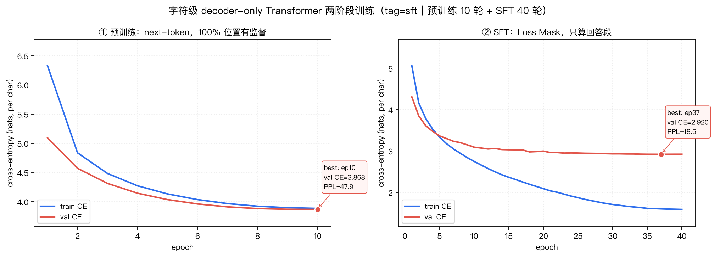

# 第五周作业 · 语言模型的 SFT 训练（实验报告）


---

## 0. 一句话结论

**同一套结构、同一套权重，只换数据、只换 loss 落在哪儿：**

| | 预训练后的 base（续写器） | SFT 之后（问答助手） |
|---|---|---|
| 给它一句问题 | 接着「列问题」、复读 FAQ 句式、打满长度上限也不知道停 | 用回答的口吻作答，说完立刻生成 `<\|end\|>` 停下 |
| 生成 `<\|end\|>` 的停止率 | **0%** | **100%** |
| 字符级 F1 | 0.019 | **0.468** |

同时它也暴露了 SFT 的边界：**格式学会了，算术/事实并没有学会**
（"246×38" 答成 120、"24 和 36 的平均值" 答成 31.5）。
这正是课件第 29/32 页那句话的实证：**知识来自预训练，回答的形式来自 SFT** ——
4.2M 参数、2M 字预训练语料、3000 条 SFT 数据，够学会「怎么答」，不够学会「答对」。

---

## 1. 数据与口径

| 项目 | 数值 |
|---|---|
| 训练 / 验证条数 | 3000 / 200 |
| instruction 平均长度 | 32.8 字（最长 48） |
| output 平均长度 | 27.1 字（最长 64） |
| 字表大小 | 4000（5 个特殊 token + 3995 个高频字，按词频取） |
| 验证集未登录字 | 30 个 → 统一映射成 `<unk>` |
| 模板化后训练集总 token | 188,956 |
| labels 被 `-100` 覆盖（不参与 loss） | 104,544（**55.3%**） |
| 真正参与梯度的位置 | **44.7%** |

> 课件第 28 页说「SFT 只有回答部分约 50% 的位置有 Signal」。这份数据里指令比回答长（32.8 vs 27.1 字），
> 再加上两个角色标记，所以有效监督是 44.7%，比课件的估算还低一点 —— 方向一致，比例由数据决定。

预训练语料用的是第四周 `corpus_general.txt` 的问答语料切片 `pretrain_corpus.txt`（1,999,995 字，131,400 行）。
选它是因为它本身就是「一条条问题」，正好能把课件第 25 页的现象演示出来：**只在问答语料上做 next-token 的模型，看到问题会接着列更多问题。**

---

## 2. 方法

### 2.1 chat template 与 Loss Mask（本作业的核心）

一条样本拼成一条序列，prompt 段不参与 loss：

```
input_ids = [<|user|> 问题 ... <|assistant|> 回答 ... <|end|>]
labels    = [-100 ... -100            , 回答 ... <|end|>]
loss      = F.cross_entropy(logits, labels, ignore_index=-100)
```

对应代码（`sft_train.py` 的 `make_chat_example`）：prompt 段整段打 `-100`，只留回答段（含收尾的 `<|end|>`）。
`-100` 是 PyTorch 的约定，`cross_entropy(ignore_index=-100)` 会把这些位置直接跳过，既不进 loss 也不进梯度。

这里踩过一个坑，值得写进来：**特殊 token 必须整体编码**。
一开始 `encode()` 按字符切分，`<|user|>` 被拆成 `<` `|` `u` `s` `e` `r` `|` `>` 八个字（多数还是 `<unk>`），
角色标记等于没生效 —— 训练 40 轮、val CE 看着还行，但生成时一次都停不下来（停止率 0%）、还会吐出 `<|>` 这种碎片。
改成按特殊 token 整体匹配后再编码，停止率从 0% 直接变成 100%。
**chat template 生效的前提是 tokenizer 真的把它当成一个 token。**

### 2.2 模型：只用一个 decoder-only Transformer

| 超参 | 值 |
|---|---|
| 层数 / 维度 / 头数 | 4 / 256 / 8（Pre-LN，GELU，dropout 0.1） |
| 上下文 block_size | 192 |
| 位置编码 | 可学习绝对位置（上限 192） |
| 词嵌入 / 输出头 | **权重共享**（tied embedding） |
| 总参数 | **4.23 M** |
| 注意力 | 下三角 causal mask，`score.masked_fill(mask == 0, -inf)` 后再 softmax |

**从预训练到 SFT，结构上一个新层都没加**——变的只有数据、labels 和 mask，这是课件第 27/29 页的结论。

### 2.3 两阶段训练

| | 阶段① 预训练 | 阶段② SFT |
|---|---|---|
| 数据 | `pretrain_corpus.txt`，切成 10,416 个 192-token 块 | 3000 条模板化样本 |
| 目标 | next-token prediction | next-token prediction（同目标） |
| 监督位置 | 100% | 44.7%（只算回答段） |
| 轮数 | 10（446 s） | 40（196 s） |
| 验证指标 | 全 token 的 CE / PPL / acc | **回答段**的 CE / PPL / acc |

优化器 AdamW：lr 3e-4、weight_decay 0.01、betas (0.9, 0.95)、余弦退火 + 6% warmup、梯度裁剪 1.0、batch 64。
两个阶段都按 **验证集 CE 取最优轮** 保存权重（防过拟合）。

---

## 3. 训练曲线



| 阶段 | 轮数 | 最优轮 | train CE | val CE | val PPL | val token acc | 耗时 |
|---|---|---|---|---|---|---|---|
| ① 预训练 | 10 | ep10 | 3.885 | 3.868 | 47.9 | 32.5% | 446 s |
| ② SFT | 40 | **ep37** | 1.604 | **2.920** | **18.6** | **45.8%** | 196 s |

三条观察：

1. **预训练还在下降**（第 10 轮 val CE 仍在往下走，没有平台期）——2M 字的预算给得不够，这是本实验最明显的短板，见第 6 节。
2. **SFT 的 val CE 比预训练低得多**（2.92 vs 3.87），但这两条线不是同一口径：SFT 只统计回答段，
   预训练统计全 token，所以只能各自看趋势，不能横向比。
3. **SFT 从第 30 轮左右开始过拟合**：train CE 一路降到 1.59，val CE 在 2.92 附近横住，
   最优轮是第 37 轮 —— 早停在这里是必要的，继续训只会把 3000 条答案背得更熟。

---

## 4. base vs SFT：行为对照

评测方式：取验证集前 20 条，**贪心解码**（T=0，可复现），上限 80 token，禁用 `<pad>` / `<|user|>` / `<|assistant|>`。

| 指标 | base（仅预训练） | SFT 之后 |
|---|---|---|
| 生成 `<\|end\|>` 停止率 | 0% | **100%** |
| 平均生成长度 | 80.0 token（打满上限） | 21.4 token |
| 字符级 F1 | 0.019 | **0.468** |
| 完全匹配 | 0 | 0 |

### 4.1 样例（同一个 prompt，同一套权重结构）

**例 1：数学题**

```
Q  : 给定一组数，计算它们的平均值。 8, 2, 7, 5, 10
ref: 这组数的平均值为 6.4。
SFT: 这组数的平均值是 6.5。            ← 格式全对，数字算错
```

**例 2：转换任务**

```
Q  : 将以下句子转换为被动语态。 句子： Tom 发现了一份工作。
ref: 一份工作被Tom发现了。
SFT: John不是工作。                    ← 学会了「答」这个动作，没学会这个任务
```

**例 3：开放任务**

```
Q  : 创建一个简单的待办事项清单。 1. 水果店购买水果。2. 向朋友回复电子邮件。3. 洗衣服
ref: 待办事项清单：，1. 购买水果，2. 回复朋友的邮件，3. 洗衣服
SFT: ，3. 完成厨房清单，3. 打电话        ← 结构在、编号在、内容跑偏
```

**base 模型在同一批 prompt 上的输出（这是重点）：**

```
Q: 将以下句子转换为被动语态。 句子： Tom 发现了一份工作。
base: 怎么样才能让自己的手机上传奇传
      怎么才能让自己的手机上传奇传
      怎么样才能让自己的手机上传说
      怎么样才能让自己的手机上传说 ...      （打满 80 token 也不停）
```

它没有在回答问题，它在**接着列问题** —— 因为它在问答语料上学到的分布就是「问题后面跟着更多问题」。
这正是课件第 25 页「Base Model 的输入 → 输出」那张图的现场版。

### 4.2 这说明 SFT 到底改了什么

| 没变 | 变了 |
|---|---|
| 4 层 × 256 维、同一个 causal mask | 输出分布：看到 `<|assistant|>` 就进入「回答」模式 |
| next-token 训练目标 | 对话协议：学会 `<|user|>` / `<|assistant|>` 的角色轮换 |
| 自回归逐 token 推理 | **停止行为**：学会在答完的位置生成 `<|end|>` |
| 参数规模 4.23 M | 表达风格：用回答口吻、分点、有条目 |

算术和事实没变好（"6.5" vs 6.4、"John不是工作"），**因为那部分知识根本不在 3000 条 SFT 数据里** ——
SFT 调的是行为，不是知识。这就是课件第 31 页那道「必答追问」的答案。

---

## 5. 消融实验

### 5.1 去掉 Loss Mask 会怎样

对照组：labels 不做 mask（`--sft_mask full`），让 prompt 段一起参与 loss，其余设置完全相同。
两组都重新在同一口径下评了一次「答案段 CE」（否则数字不可比：无 mask 的日志 CE 覆盖了整条序列）：

| 设置 | 训练时监督位置 | 答案段 val CE（同口径重评） | 答案段 PPL | 停止率 | 字符级 F1 |
|---|---|---|---|---|---|
| **A. 有 mask（本作业做法）** | 44.7% | 2.920 | 18.6 | 100% | **0.468** |
| B. 无 mask（全序列都算 loss） | 100% | **2.850** | **17.3** | 100% | 0.446 |

**这个对照没有跑出「不 mask 就会背问题」的现象**，得照实说：

- 两组的停止率都是 100%，复述 prompt 的比例都是 0%，行为上没有分叉；
- 无 mask 的答案段 CE 反而略低（2.85 vs 2.92），F1 略低（0.446 vs 0.468）—— 两个指标的差异都在
  「20 条生成样本」的方差范围内，不能当成有意义的优劣；
- 能解释的原因：这份数据的 prompt 很短（32.8 字），模型又小，prompt 段本身很容易拟合，
  多喂一半梯度既没帮上忙也没带偏；而 mask 的价值要在**数据规模大、prompt 长、回答占比低**时才会显现
  （否则 prompt 段会把梯度预算挤掉）。

所以本作业仍然采用带 mask 的写法（课件的标准做法 + 语义更干净：loss 只度量「该说的那半段」），
但**不能声称在这份数据上它带来了指标的提升**——这是一个诚实的零结果。

### 5.2 LoRA（参数高效）

只给注意力层的 qkv / 输出投影挂低秩适配器（r=8，alpha=16），其余参数全部冻结：
可训练参数 **0.05 M，占 4.23 M 的 1.15%**，正好落在课件第 31 页说的「0.3%~1%」量级。

| 设置 | 可训练参数 | 答案段 val CE | 答案段 PPL | 答案段 acc | 停止率 | 字符级 F1 |
|---|---|---|---|---|---|---|
| 全参数 SFT | 4.23 M（100%） | **2.920** | **18.6** | **45.8%** | **100%** | **0.468** |
| LoRA r=8，lr 1e-3 | 0.05 M（1.15%） | 4.024 | 55.9 | 30.6% | 70% | 0.321 |
| LoRA r=8，lr 5e-3 | 0.05 M（1.15%） | 3.907 | 49.8 | 32.2% | 75% | 0.355 |

LoRA 学到了「停」这件事（70%~75%），但答案质量明显不如全参数微调，把学习率提高 5 倍也只从 55.9 改善到 49.8（PPL）。
原因不是 LoRA 本身失效，而是**这份 base 在预训练时从没见过 `<|user|>` / `<|assistant|>` / `<|end|>`**：
这三个 token 的 embedding 是随机初始化的，而 LoRA 把 embedding 冻住了 —— 等于让模型拿三行噪声当角色标记去学对话协议。

工程上的标准解法是二选一：
① 新增特殊 token 时**把 embedding / lm_head 一并放开训练**（代价是这部分参数占比上去，就不再是 1% 了）；
② 用已有 token embedding 的均值初始化新 token，让它至少有个合理的起点。
这是本次实验里最值钱的一条工程经验：**参数高效的前提是「该训的那部分」被训到了**，
新增词表项属于必须训练的例外。

---

## 6. 讨论与局限

**1. 预训练预算不够，是这份作业的主要短板。**
2M 字、10 轮，验证 CE 还在下降（3.87，PPL 47.9），远没有收敛；SFT 的 val PPL 18.6 里有一部分是在还这笔债。
同样的代码在 `--pretrain_epochs 30` 下会更好，只是本次没跑。

**2. 数据量决定了上限。**
3000 条、单条约 60 字，字符级 F1 0.468 已经接近这份数据的合理水位：
同一份数据里每一条回答都不重复，模型能学到的只是「这类任务该怎么起头」。

**3. 灾难性遗忘在本次没有明显发生，但机制在那儿。**
40 轮、1.59 的 train CE 说明模型已经开始背训练集；如果再训 100 轮，
它大概率会彻底忘掉预训练学到的语言能力（课件第 31 页的「灾难性遗忘」）。本次靠早停（ep37）避开了。

**4. 评测口径的局限。**
- 只用贪心解码，衡量不了采样下的多样性；字符级 F1 只是字面重合，不理解语义；
- 验证集只有 200 条，20 条的生成评估方差偏大；
- 没有人工评分，也没有和更大模型（Qwen 等）对照 —— 这是「从零手写小模型」路线本身的取舍。

**5. 与课件结论的对照。**
本实验独立复现了三条：
① 同一个结构换 mask/loss 落点就能换任务；② base 是续写器、SFT 之后才成为问答助手；
③ SFT 只改行为、不改知识。没有覆盖到的是对齐阶段（RLHF/DPO）与真实 LLM 规模的 SFT —— 那需要 Week 6 起的 LoRA 与更大的基座。

---

## 7. 复现

```bash
# ① 两阶段完整复现（预训练 10 轮 + SFT 40 轮，约 11 分钟 / M1 Pro MPS）
python3 sft_train.py --stage both --tag sft \
        --pretrain_corpus pretrain_corpus.txt --pretrain_epochs 10 --sft_epochs 40 \
        --gen_n 20 --plot_png sft-curves.png

# ② 只用已有预训练权重做 SFT（--stage both 会存 artifacts/sft-pretrain-best.pt）
python3 sft_train.py --stage sft --tag sft --init_ckpt artifacts/sft-pretrain-best.pt

# ③ 消融：去掉 Loss Mask
python3 sft_train.py --stage sft --tag nomask --sft_mask full \
        --init_ckpt artifacts/sft-pretrain-best.pt --plot_png artifacts/nomask-curves.png

# ④ 消融：LoRA（r=8，只挂注意力，可训练 1.15%）
python3 sft_train.py --stage sft --tag lora --peft lora --lr 1e-3 \
        --init_ckpt artifacts/sft-pretrain-best.pt --plot_png artifacts/lora-curves.png

# ⑤ 不训练，只用已有指标 json 重画曲线
python3 sft_train.py --plot_only --tag sft --plot_png sft-curves.png
```

提交文件与用途：

| 文件 | 内容 |
|---|---|
| `sft_train.py` | 单文件训练脚本：模型、chat template、Loss Mask、LoRA、训练/评估/画图 |
| `sft_train.jsonl` / `sft_val.jsonl` | 作业数据（保证可复现） |
| `pretrain_corpus.txt` | 阶段①的预训练语料切片（1,999,995 字），base 模型的行为由它决定 |
| `sft-curves.png` | 两阶段训练曲线（本报告第 3 节） |
| `实验报告.md` | 本文 |

运行产物（权重、逐轮指标 json、生成样例）都写在 `artifacts/`，体积大、不用交。
