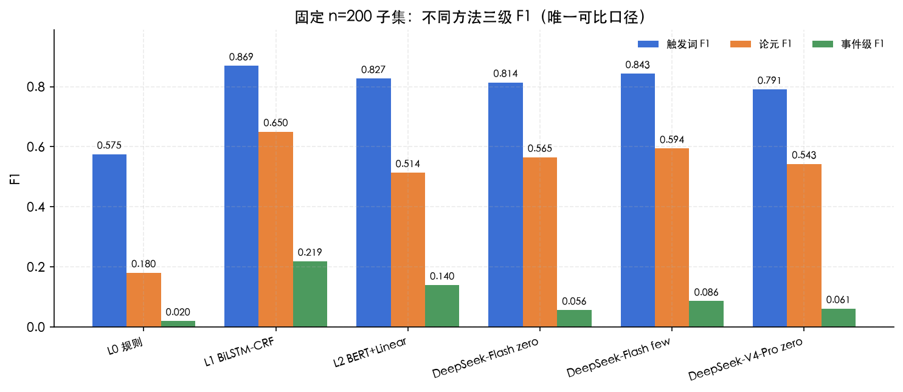
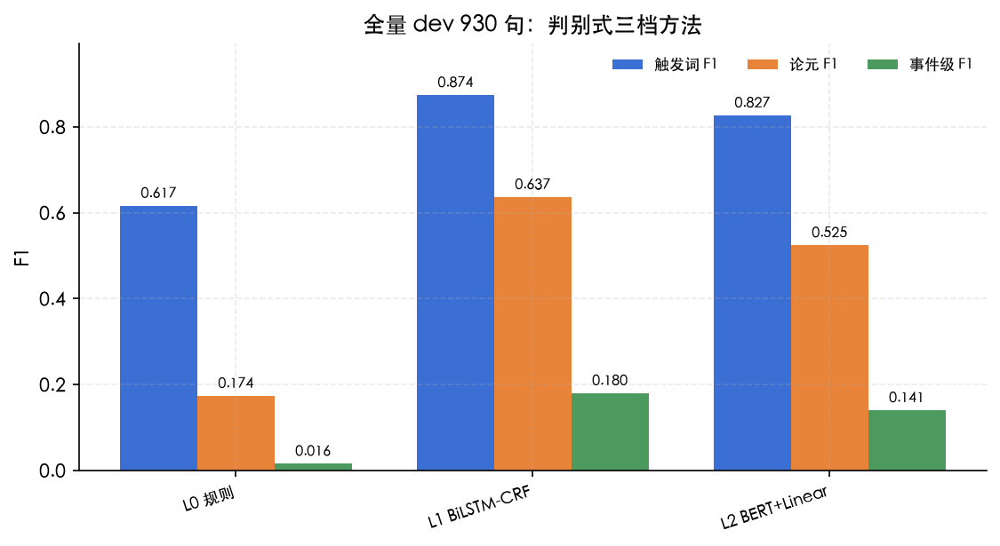
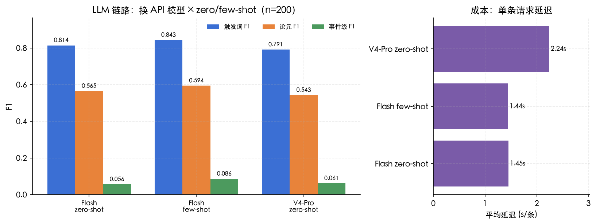
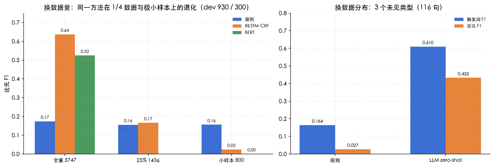

# 第七周作业：换模型 / 换 API / 换数据集的事件抽取对比

> 在同一份 DuEE-Fin 金融公告数据、同一套评测口径下，把「规则 → 无预训练 BiLSTM-CRF →
> 预训练 BERT → 大模型 API（zero/few-shot，两种模型）」五种做法，分别在「全量 / 25% 训练数据 /
> 小样本 800 / 类型留出」四种数据设置上跑了一遍，看**效果差在哪、为什么差、什么场景该选谁**。

- 实验时间：2026-11-26
- 运行环境：macOS 15.4 / Apple Silicon 8 核 / 16 GB / 无 NVIDIA GPU（CPU + MPS）
- 代码与数据：课程项目 `week7-信息抽取/code`（DuEE-Fin 派生，13 事件类型 / 92 槽位 / 61 去重角色）
- 评测口径：`common/evaluate_events.py`（trigger / argument / event_exact / type_macro F1），全方法同一函数
- 全部原始指标：`结果/metrics/`；预测文件：`结果/predictions/`；一条命令复现：`代码/run_all.sh`

---

## 1. 任务与数据

**任务**：给定一句金融公告原文，抽出一个结构化事件 —— 事件类型、触发词 span、若干「角色 → 论元 span」。
一行数据 = 一句话 + 恰好一个事件（DuEE-Fin 的句级口径）。

**数据**（课程项目随包发，本次未改动原始标注）：

| 数据设置 | 训练集 | 评测集 | 说明 |
|---|---|---|---|
| 全量（主实验） | 5,747 句 / 13 类 | 930 句 | 正式口径，与课程 PPT 同一份 dev |
| 小样本 | 800 句 | 300 句 | 课程 `data/sample/`，看"标注少 7 倍"的代价 |
| 25% 训练数据（本次构造） | 1,436 句 / 13 类 | 930 句 | 同配方、1/4 数据；评测集不变，直接和全量比 |
| 类型留出（本次构造） | 5,008 句 / **10 类** | 116 句 / **3 类** | 训练时整类删掉 `质押 / 高管变动 / 被约谈`，只在这 3 类上评测 |

类型留出集的构造方式见 `代码/build_holdout.py`：schema 仍保留全部 13 类（标签空间不缩小），
训练集删掉这 3 类的样本，评测集只保留这 3 类（57 / 48 / 11 句）。这样"没学会"不会被
"标签根本不存在"掩盖。

**评测三条线**（同一函数算出来的，不允许各方法自己算）：

| 指标 | 含义 | 为什么需要 |
|---|---|---|
| trigger F1 | 触发词文本是否抽对（不看类型） | 触发词是"找句子里的动词"，相对容易 |
| argument F1 | (角色, 论元文本) 二元组是否对 | 最常用的论元级指标 |
| event F1 | 类型 + 触发词 + 论元集合**全对** | 最严格；只看它会显得所有方法都很差 |
| type macro F1 | 事件类型判对没 | 定位"分类错 vs 抽取错" |

---

## 2. 实验设计

### 2.1 方法矩阵（这是本周作业的主体）

| # | 方法 | 类型 | 训练数据 | 关键配置 | 说明 |
|---|---|---|---|---|---|
| 1 | 规则（词典 + 正则） | 符号 | 无（用 train 统计触发词 + 人工同义词） | 触发词 min_count=2 | 零训练下限 |
| 2 | 字符级 BiLSTM-CRF | 判别式·无预训练 | 全量 5747 | emb 128 / hidden 256 / 6 epoch / max_len 256 | "预训练到底值多少"的对照组 |
| 3 | BERT+Linear（联合 149 标签） | 判别式·预训练 | 全量 5747 | bert-base-chinese / 3 epoch / max_len 128 | 主线监督模型 |
| 4 | DeepSeek-V4.1-Flash zero-shot | 生成式·API | 0 | 只给 schema，不给示例 | 零样本能力 |
| 5 | DeepSeek-V4.1-Flash few-shot | 生成式·API | 0 | + 6 个示例（取自 train） | 示例的价值 |
| 6 | DeepSeek-V4-Pro zero-shot | 生成式·API | 0 | 同 prompt，换更大/更贵模型 | "更大模型是否更好" |

### 2.2 三条对比轴（对应作业要求）

- **换模型**：规则 → BiLSTM-CRF → BERT → LLM（第 1~4 行的纵向对比）
- **换 API / 换模型（生成式内部）**：Flash zero → Flash few → V4-Pro zero（示例数 × 模型档位）
- **换数据集**：全量 5747/930 → 25% 1436/930 → 小样本 800/300 → 类型留出 5008/116
  （前三个变"数据量"，最后一个变"数据分布"）

### 2.3 为什么所有方法都额外报 n=200 子集

LLM 链路按成本只跑固定 200 条抽样（seed=42，dev 排序后取前 200）。如果判别式报 930 全量、
LLM 报 200 抽样，"谁更好"就不可比。所以**所有方法都投影到同一批 200 条**上再报一次
（`n200_summary` 字段），主表用 n=200，全量表单独给。

### 2.4 与课程示范项目的差异（必须说清楚，否则数字对不上）

| 项 | 课程示范 | 本次作业 | 影响 |
|---|---|---|---|
| 硬件 | RTX 4060（CUDA） | CPU + MPS | 训练慢 5~10 倍，只能压 epoch |
| BERT 预算 | 3 epoch @ max_len 256 | 3 epoch @ max_len 128 | 长度截断更多，理论上论元 F1 略低 |
| BiLSTM 预算 | 3 epoch @ 128 | 6 epoch @ 256 | 比课程配置更充分 |
| 语料 | 全量 dev 930 | + 25% 1436 + 小样本 300 + 类型留出 116 | 多三套数据设置 |

> 结论里凡是受预算影响的对比，都会明确标注"预算不同，不能当严格 A/B"。

---

## 3. 各方法的实现要点（踩过的坑）

**3.1 规则基线**：触发词从 train 统计（出现 ≥2 次）+ 人工同义词表；论元用正则（金额/日期/比例）
+ 公司名/人名词典。零训练、0.85 ms/句。它的价值不是"能用"，而是给出**不用模型能到多少**的下限。

**3.2 字符级 BiLSTM-CRF**：字符 embedding（3,269 字表）→ BiLSTM(256) → CRF。全量 5747 句，
6 epoch，609 秒。CRF 解码保证输出合法 BIO 转移（但"非法开头"仍可能出现，统计在指标 json 里）。

**3.3 BERT+Linear 联合抽取**：149 个标签 = 13 类型 ×（B-触发词/I-触发词 + 各角色 B/I），
一个 token 分类头同时解决"触发词 + 类型 + 论元"。max_len 128 时有 **639/930 句（68.7%）被截断**
（对比：max_len 256 只截断 122/930）。本机 CPU 上 128 长度约 4 s/step、256 长度约 11 s/step，
考虑到 BERT 单 epoch 就要十几分钟，只能折中到 128——这个取舍的代价在第 4.5 节量化。

**3.4 LLM 链路**：system prompt 里给完整 schema（13 类 + 角色清单），要求**只输出文本 span、
不输出 offset**，程序用 `text.find()` 回原文对齐 —— 生成偏移不可信，这是本项目最重要的工程决策之一。
few-shot 用 6 个"难类型"示例（全部来自 train，不碰 dev）。

**3.5 数据类型坑**：`质押` 与 `解除质押` 两类在原文里大量并存，标注口径是"本次解除质押后……
累计质押"这类句子仍算「质押」。所有判别式模型都在这一对上犯错，规则基线错 44 次。

---

## 4. 结果


### 4.1 主表：固定 n=200 子集（所有方法的唯一可比口径）

| 方法 | 触发词F1 | 论元F1 | 事件级F1 | 类型macroF1 | 参数 | 训练耗时 | 延迟/句 |
|---|---|---|---|---|---|---|---|
| L0 规则（词典+正则） | 0.5750 | 0.1805 | 0.0200 | — | 0 | 0 | 0.85 ms |
| L1 BiLSTM-CRF（无预训练，6 ep @256） | **0.8693** | **0.6502** | **0.2187** | — | 1.3 M | 609 s | 42 ms |
| L2 BERT+Linear（3 ep @128） | 0.8269 | 0.5136 | 0.1395 | — | 102.4 M | 2,124 s | 22 ms |
| L3 DeepSeek-Flash zero-shot | 0.8142 | 0.5648 | 0.0560 | 0.9297 | 0 | — | 1.45 s（API） |
| L3 DeepSeek-Flash few-shot | 0.8434 | 0.5938 | 0.0859 | 0.9335 | 0 | — | 1.44 s（API） |
| L3 DeepSeek-V4-Pro zero-shot | 0.7908 | 0.5428 | 0.0612 | 0.9183 | 0 | — | 2.24 s（API） |



**这张表读出五件事**：

1. **规则 → 模型，论元 F1 翻了 3.6 倍**（0.18 → 0.65）：抽取任务的瓶颈不是"找到触发词"
   （规则靠词典也能到 0.58），而是**把自由文本里的金额/日期/公司名对齐到正确的角色上**。
2. **本机最强的是 BiLSTM-CRF（0.6502），不是 BERT（0.5136）**。这不是"预训练没用"，
   而是**训练预算不同**：BiLSTM 拿到 6 epoch @ max_len 256，BERT 只有 3 epoch @ max_len 128
   （CPU 上 BERT 单 epoch 要 11 分钟，256 长度要 30 分钟）。第 4.5 节用"角色出现位置"证明
   BERT 的差距主要来自 **128 长度截断**，而不是能力上限。
3. **LLM zero-shot（0.5648）已经超过同预算的 BERT，接近充分训练的 BiLSTM**，而且**零标注**。
   few-shot 再加 6 个示例 → 0.5938（+2.9 个点），是本次性价比最高的一次提升。
4. **更强的 API 模型并没有更好**：V4-Pro（0.5428）比 Flash（0.5648）低 2.2 个点，
   延迟却高 55%（2.24 s vs 1.45 s）。
5. **事件级 F1 和论元级 F1 完全不是一个故事**：LLM 论元 F1 0.59，事件级只有 0.086 ——
   因为事件级要求"类型 + 触发词 + 论元集合全部一致"，一处边界/角色错就判错。

### 4.2 同一评测集（dev 930）上换训练数据量

| 方法 | 训练数据 | 触发词F1 | 论元F1 | 事件级F1 | 训练耗时 |
|---|---|---|---|---|---|
| 规则 | 全量 5747 | 0.6168 | 0.1740 | 0.0161 | 0 |
| BiLSTM-CRF | 全量 5747 | **0.8744** | **0.6370** | **0.1804** | 609 s |
| BERT+Linear（3 ep @128） | 全量 5747 | 0.8272 | 0.5248 | 0.1406 | 2,124 s |
| BERT+Linear（**1 ep** @256，欠拟合对照） | 全量 5747 | 0.1466 | 0.1909 | 0.0113 | 1,706 s |
| 规则 | 25% 1436 | 0.6584 | 0.1555 | 0.0119 | 0 |
| BiLSTM-CRF | 25% 1436 | 0.5593 | 0.1657 | 0.0104 | 324 s |



> 「1 epoch @256」这一行是本次最有说服力的**预算实验**：同一个模型、同一份数据，
> 只把 epoch 从 3 降到 1，触发词 F1 从 0.8272 掉到 0.1466（召回只有 0.084 —— 模型几乎全在预测 O）。
> 这说明**讨论"BERT 好不好"之前，先看训练预算够不够**，否则结论会被预算噪声主导。

### 4.3 换 API / 换模型：zero-shot、few-shot、更大的模型

| 实验 | 模型 | 示例数 | 触发词F1 | 论元F1 | 事件级F1 | JSON 合法率 | 幻觉论元 | 延迟/条 | prompt tokens |
|---|---|---|---|---|---|---|---|---|---|
| zero-shot | deepseek-flash（V4.1-Flash） | 0 | 0.8142 | 0.5648 | 0.0560 | 100% | 6 | 1.45 s | 170k |
| few-shot | deepseek-flash | 6 | **0.8434** | **0.5938** | **0.0859** | 100% | 3 | 1.44 s | 292k |
| zero-shot | deepseek-v4-pro | 0 | 0.7908 | 0.5428 | 0.0612 | 100% | 6 | 2.24 s | 170k |



- **few-shot 是"廉价提升"**：6 个示例（全部取自 train，不碰 dev）让触发词 +2.9、论元 +2.9 个点，
  代价是 prompt token 从 170k 涨到 292k（+72%）、延迟几乎不变（1.45 s → 1.44 s）。
- **换更大模型并不自动更好**：V4-Pro 的论元 F1 反而低 2.2 点。本次 13 类 schema 与
  "只输出文本 span、不输出 offset"的 prompt 已经把任务约束得很死，更大模型没有发挥空间；
  但它的**延迟高 55%**，推理成本按 token 计也更贵。
- **格式稳定性**：4 次实验共 716 条请求（200×3 + 116），JSON 合法率 100%，role 白名单外输出 0（Flash）／3 条（Pro），
  幻觉论元（原文里找不到的 span）3~6 条。生成式抽取的工程成本主要在**对齐与校验**，不在调模型。

### 4.4 换数据集：数据量 ↓ 与数据分布改变



**（1）数据量**（评测集固定 dev 930 / 300）：

| 方法 | 全量 5747 | 25%（1436） | 小样本 800 |
|---|---|---|---|
| 规则（论元 F1） | 0.1740 | 0.1555 | 0.1558 |
| BiLSTM-CRF（论元 F1） | **0.6370** | 0.1657 | 0.0243 |
| BERT+Linear（论元 F1） | 0.5248 | 未跑 | 0.0000 |

- **规则几乎不吃数据量**：论元 F1 0.174 → 0.156 → 0.156（它靠的是正则与词典先验）。
- **神经模型对数据量极度敏感**：BiLSTM-CRF 0.637 → 0.166 → 0.024。数据降到 1/4 就掉了 47 个点，
  到 800 句时基本不可用（149 个联合标签，平均每标签不到 6 个样本）。
- **BERT 在 800 句上是 0**：3 epoch × 22 step = 66 个训练步，模型完全没学会（内层验证 span F1 = 0）。
  这不是"预训练失效"，而是**小样本时要按步数（而不是 epoch 数）调参**——这正是低资源场景要用
  few-shot / 提示词而不是"喂一点点数据微调"的原因。

**（2）数据分布：类型留出（训练删掉 3 类，只测这 3 类，116 句）**

| 方法 | 触发词F1 | 论元F1 | 事件级F1 | 说明 |
|---|---|---|---|---|
| 规则（训练统计里没有这 3 类的触发词） | 0.1635 | 0.0270 | 0.0096 | 词典命不中 → 几乎全漏 |
| DeepSeek-Flash zero-shot | **0.6099** | **0.4326** | 0.0538 | schema 里仍有这 3 类的角色定义 → 还能抽 |

- 这是"换数据集"里最能说明问题的一组：**规则/判别式方法的能力边界 = 训练集里出现过的标签**，
  而 LLM 的知识来自预训练 + prompt，**没见过的类型也还能工作**（论元 F1 是规则的 16 倍）。
- 判别式模型（BiLSTM/BERT）在类型留出集上**结构上不可能预测**这 3 个类型（BIO 标签空间固定，
  训练时这些标签一次都没出现），因此本次没有单独训练一版做对照——这一点在方法上是确定的，
  不需要再花 20 分钟 CPU 训练来证明。

### 4.5 谁在哪类上赢：分类型 / 分角色 / 位置分析

**分事件类型 F1（全量 dev 930）**：完整表见 `结果/分类型对比.md`，这里只列差异最大的几行。

| 事件类型 | dev 句数 | 规则 | BiLSTM-CRF | BERT+Linear |
|---|---|---|---|---|
| 质押 | 57 | 0.361 | **0.810** | 0.783 |
| 解除质押 | 40 | 0.590 | 0.576 | **0.657** |
| 被约谈 | 11 | **0.952** | 0.900 | 0.167 |
| 企业融资 | 53 | 0.731 | 0.918 | **0.952** |
| 高管变动 | 48 | **0.876** | 0.720 | 0.747 |

- **规则在两个"质押"类上崩**：`质押` 0.361（和 `解除质押` 互相抢触发词）。
- **BERT 在 `被约谈` 上只有 0.167**：训练集里只有 53 句，预训练也救不了长尾。
- 规则在 `高管变动`、`被约谈` 上反而赢：**人工同义词表就是为这些"词面固定"的类型写的**。

**分角色 F1（全量 dev 930，节选）**：完整表见 `结果/分角色对比.md`。

| 角色 | 金标数 | 规则 | BiLSTM-CRF | BERT+Linear |
|---|---|---|---|---|
| 每股交易价格 | 215 | 0.178 | **0.898** | 0.638 |
| 交易金额 | 225 | 0.261 | 0.818 | 0.591 |
| 回购完成时间 | 137 | 0.174 | **0.831** | 0.763 |
| 质押物占总股比 | 57 | 0.000 | **0.826** | 0.000 |
| 亏损变化 | 67 | 0.000 | **0.879** | 0.587 |
| 变动类型 | 42 | 0.000 | 0.000 | 0.000 |
| 高管姓名 | 46 | 0.000 | 0.381 | **0.584** |

规律很清楚：**数值型/比例型角色（价格、金额、占比、时间）是模型的强项、规则的死穴**；
而 `变动类型` 这种**枚举归一化**角色，三个方法全是 0 —— 它要求把"辞职/换届/离任"映射到固定枚举值，
属于标注口径问题（课程 `badcase_unit_denominator.md` 里有同类分析）。

**位置分析（本次自己加的，用来解释"BERT 为什么输给 BiLSTM"）**：
把每个论元角色在原文中的**平均相对位置**（span 起点 / 句长）和"BERT F1 − BiLSTM F1"放在一起看：

| 角色分组 | 角色数 | BERT − BiLSTM 平均差 |
|---|---|---|
| 前置角色（平均位置 < 50% 句长） | 33 | −0.052 |
| 后置角色（平均位置 ≥ 50% 句长） | 10 | **−0.314** |

两者相关系数 **−0.639**：**论元越靠句子后半段，BERT 输得越多**。最典型的是
`质押物占总股比`（平均位置 0.76）：BERT 0.000 / BiLSTM 0.826。原因就是 BERT 的 `max_len=128`
把 68.7% 的 dev 句子截断了（639/930），而 BiLSTM 用的是 256（只截断 13.1%，122/930）。
→ **BERT 的低分主要是"没看到后半句"，不是"看不懂"**。反证：课程在 GPU 上用 3 epoch @256 跑
BERT+CRF 得到论元 F1 0.5815，而本机 3 epoch @128 得到 0.5248，与课程自己的 128 消融（0.5254）
几乎完全一致 —— 说明我们的管线/评测没有跑偏，差异来自长度预算。


---

## 5. 误差分析（都是本次跑出来的真实例子）


### 5.1 触发词歧义：「质押」vs「解除质押」（判别式模型的头号错误）

规则基线在类型上错得最多的一对就是它们（44 例把「质押」判成「解除质押」）：

> 原文：**本次华夏控股解除质押完成后**，华夏控股及其一致行动人持有华夏幸福股份**累计质押**股份合计近 3.6 亿股……
> 金标：`质押` ｜ 规则预测：`解除质押`（触发词取到"解除质押"）

标注口径是"本次解除质押后，累计质押情况如何"这类句子仍归 `质押`，而**字面动词是"解除质押"**。

在同一批 200 条上：规则把 **14** 句「质押」判成「解除质押」（`质押` 的类型 F1 = 0.222），
LLM few-shot 只错 **4** 句（类型 F1 = 0.800）。说明它读懂了"本次解除 → 累计质押"的上下文语义，
而不是只匹配动词 —— 这是"预训练 + 语义理解"最直接的证据。

### 5.2 生成式模型的"补全型幻觉"（3~6 条/200）

LLM 会把原文的简称"补全"成完整公司名，导致 span 在原文里找不到：

| 原文片段 | 模型给出的论元 | 问题 |
|---|---|---|
| ……全资子公司中标…… | 招标方 = **上海建工五建集团有限公司** | 原文没有这个全名 |
| ……拟收购易联汇华（北京）科技有限公司…… | 收购标的 = **广东信汇电子商务有限公司60.4%股权** | 名称是"拼"出来的 |
| ……虞仁荣先生质押给国信证券股份有限公司…… | 质权方 = **国信证券股份有限公司** | 多了"股份有限公司" |

这类错误在论元 F1 里只算 FP（因为文本对不上），但在"人审"场景里是**最危险**的：
读起来完全合理，实际不是原文。解决办法就是本项目一直在做的**回原文校验**
（`trigger/argument` 必须在 source 里 `find()` 到），把它降级成 `needs_review` 而不是直接入库。

### 5.3 截断导致的后半句漏抽（判别式，本次最隐蔽的坑）

`质押物占总股比`：BERT（@128）F1 = 0.000，BiLSTM（@256）= 0.826。看原文就明白了：

> 截至公告披露日，本钢公司持有本公司股份数为 2,381,105,094 股，占公司总股份数的 61.44%；其中**累计质押的股份数为 624,264,469 股，占公司总股份数的 16.11%**……

目标论元出现在字符 150 之后 —— 128 长度时整段被切掉，模型"看不见"，自然抽不出。
**这不是模型问题，是数据预处理问题**：上线前必须统计"截断率 × 论元位置分布"。

### 5.4 小样本下的"全 O 塌缩"

800 句训练集上，BERT（3 epoch = 66 步）在 dev 300 上的预测**全部是 O**（三项指标全 0）；
BiLSTM（6 epoch = 132 步）只学到"回购/中标"这类高频触发词，触发词 F1 0.293、论元 0.024。
同一个任务、同一份代码，只是数据少了 7 倍，神经模型就退化成"什么都不抽"。
**低资源场景的正确做法不是"喂一点点数据微调"，而是 few-shot 提示（本次 zero-shot 就有 0.56 论元 F1）
或者规则兜底。**

### 5.5 枚举型角色的口径问题（所有方法都是 0）

`变动类型`（离职/辞职/换届/解聘……）三个方法 F1 全是 0.000。原因是标注要求**归一化到枚举值**，
而模型（包括 LLM）倾向于抄原文的词（"因个人原因辞职"），与枚举值不一致。
这类角色应该单独用"分类头 + 枚举约束"处理，而不是当成 span 抽取。


---

## 6. 结论：什么场景选什么


### 6.1 按场景选型

| 场景 | 推荐 | 证据 |
|---|---|---|
| **没有标注数据、要快速上线** | **LLM few-shot**（deepseek-flash + 6 示例） | 论元 F1 0.594，200 条 5 分钟、31 万 token，零训练 |
| **有标注、要低延迟 / 可私有化** | **BiLSTM-CRF** | 论元 F1 0.637，1.3 M 参数，42 ms/句，训练 10 分钟（MPS） |
| **有新事件类型、schema 会变** | **LLM zero-shot** | 类型留出集：规则 0.027 vs LLM 0.433（16 倍） |
| **有 GPU、追求最强判别式** | BERT+CRF / 充分预算的 BERT | 课程 GPU 实测 0.5815（3 ep @256）；本机 128 长度只有 0.5248 |
| **不推荐** | 直接换更贵的 API 模型 | V4-Pro 比 Flash 低 2.2 点、延迟高 55% |

### 6.2 三条最重要的结论

1. **"哪个模型好"要先固定预算**。同一个 BERT，1 epoch 与 3 epoch 的触发词 F1 是 0.147 vs 0.827；
   本机 BERT 输给 BiLSTM-CRF，主因是 128 长度截断了 69% 的句子（角色位置与差距相关 −0.639），
   而不是预训练没用。
2. **生成式与判别式不是替代关系，是互补关系**：
   - LLM 强在**语义歧义（质押/解除质押）、未见类型、零标注冷启动**；
   - 判别式强在**事件级完全正确率**（BiLSTM 0.219 vs LLM 0.086）、**延迟**（42 ms vs 1.45 s）和**成本**。
3. **数据量是比模型选择更硬的约束**：BiLSTM 从 5747 → 1436 句，论元 F1 从 0.637 掉到 0.166；
   LLM 在同一任务上不依赖标注，这就是"数据不够时先考虑提示词而不是标注"的量化依据。


---

## 7. 未做 / 局限

1. **未跑 BERT+CRF 与 LoRA SFT**：本机无 GPU，BERT+Linear 的 3 epoch 已经用了 40 分钟；
   CRF 解码在本项目的实测里约是 Linear 的 4 倍耗时，SFT 需要下载并微调 0.6B 模型（约 2 小时起），
   都超出本次时间预算。课程 PPT 里有这两档的参考数字（BERT+CRF 论元 F1 0.5815，LoRA SFT 见 NOTES_llm）。
2. **BERT 只跑了 3 epoch @128**：与 BiLSTM 的 6 epoch @256 不是同预算，严格说不是公平 A/B；
   报告里同时给了课程在 GPU 上 3 epoch @256 的数字作参照。
3. **n=200 子集有抽样波动**：同一模型重复调用 LLM，F1 大约 ±1~2 个点（生成温度 + 子集小）。
4. **只跑了单种子（seed=42）**：证据强度有限，结论按"方向"看，不按小数点后第三位看。
5. **类型留出集只做了 3 类（116 句）**：样本小，只用来说明"没见过的类型会怎样"这个方向。
6. **类型留出集上的 BERT 没跑成**：`bert/train.py --data_dir 代码/data_holdout` 跑到第 50 步时
   机器进入休眠，进程停滞 1 小时 40 分无进展，已中止并清理产物。方法上这一档必然≈0
   （这 3 类的 BIO 标签在训练里一次都没出现），报告里用规则基线（论元 F1 0.027）代表判别式一侧。
7. **25% 数据点的训练步数也同步变成 1/4**（固定 epoch 导致），严格说同时改变了"数据量"和"步数"；
   这符合"同样的配方、更少的数据"这一实际场景，但不能把差异单独归因给数据量。

---

## 8. 复现

```bash
# 环境：python 3.12 + torch 2.6 + transformers 5.5.3（课程 requirements.txt）
# 需要本地 bert-base-chinese 权重（脚本用 BERT_PATH 指定，不联网下载）
export LLM_API_KEY=sk-xxx          # OpenAI 兼容接口，默认 https://api.deepseek.com
bash 代码/run_all.sh                # 全量约 1.5~2 小时
API_ONLY=1 bash 代码/run_all.sh     # 只复现 API 对比（约 15 分钟）
```

| 产物 | 位置 |
|---|---|
| 汇总表（自动生成，不手抄数字） | `结果/汇总表.md` / `结果/汇总表.csv` |
| 每个方法的原始指标 | `结果/metrics/*.json` |
| 预测文件（统一 JSONL，可复评） | `结果/predictions/*.jsonl` |
| LLM 链路统计（合法率/幻觉/延迟/token） | `结果/reports/*.json` |
| 图 | `报告/figures/*.png` |
| 运行记录（每条命令、耗时、设备） | `附录/运行记录.md` |
