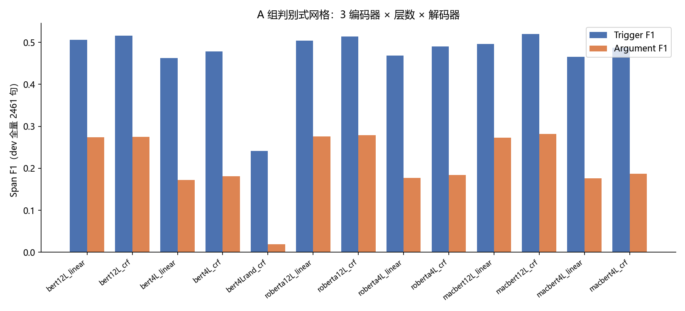
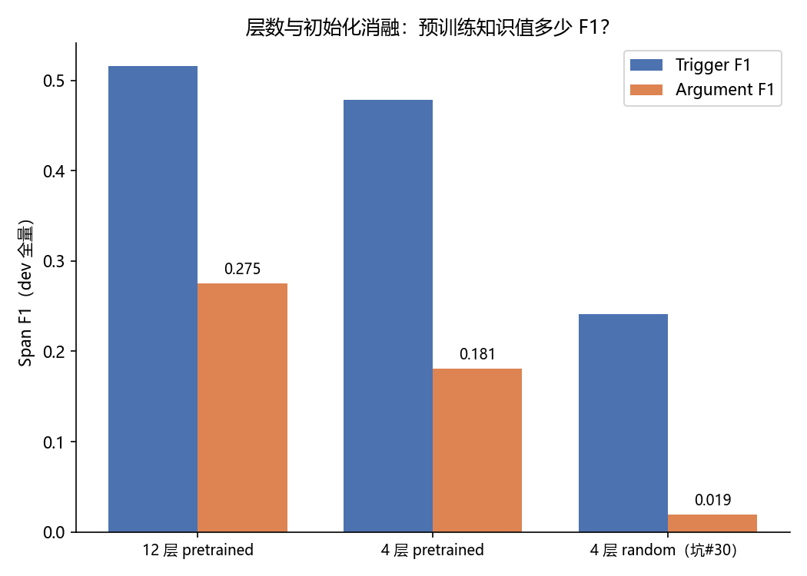
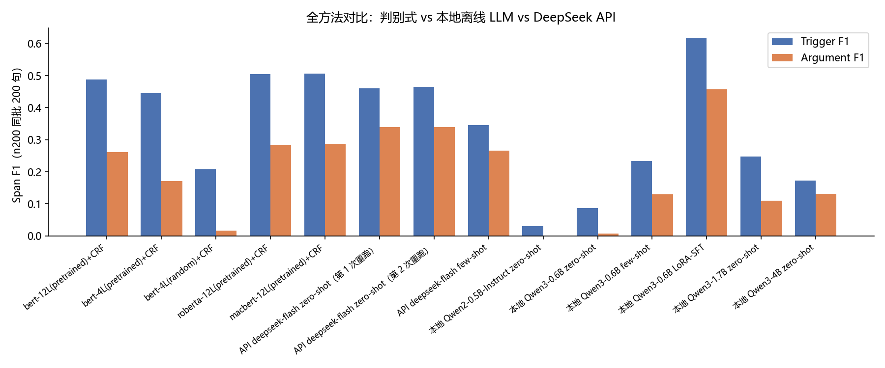
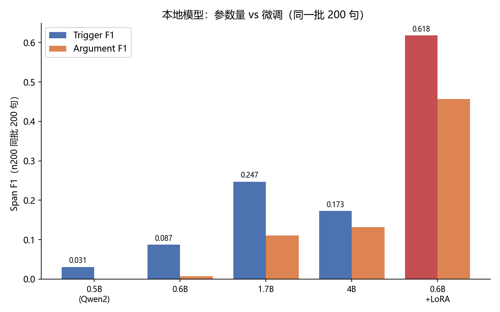

# 第七周作业：FewFC 事件抽取 —— 判别式 / 本地 LLM / 云端 API 三条路线对比

> 数据集：FewFC（金融小样本事件抽取，10 事件类型 / 18 论元角色，CC BY-SA）
> 路线：中文 BERT 系判别式（3 编码器 × 4/12 层 × Linear/CRF）· 本地离线 LLM（0.5B–4B，zero/few-shot/LoRA）· DeepSeek API
> 环境：RTX 5050 Laptop 8GB + 32GB，torch 2.11+cu128 / transformers 5.23，conda py312
> 统一口径：dev 全量 2548 句 + n200 固定子集（200 句 / 301 事件），唯一评测函数 `common/evaluate_events.py`

---

## 0. 一句话结论

**同一批 200 句上，胜负是分裂的：微调后的本地 0.6B 小模型全面领先（trigger 0.618 / argument 0.457 / event 0.171），中文 BERT（MacBERT-12L+CRF，0.506 / 0.288）触发词强于云端 API（0.460 / 0.340）但论元更弱，而 0.6B 的 zero-shot 只有 0.087 / 0.008、9 例 few-shot 0.234 / 0.130。也就是说：**"本地小模型不行"这个判断只对 zero/few-shot 成立，用 3548 句做一次 LoRA（1 epoch、单卡 8GB、50 分钟）就把 trigger 从 0.087 拉到 0.618，反超云端 API 15.8pp、反超 BERT 11.2pp**。判别式的 event_exact 天花板被 30.7% 的多事件句钉在 0.07 附近，这不是调参问题，是单序列解码的结构性问题。**

### 0.1 本版相对 22:30 版的修订（把结论改对）

| 22:30 版的结论 | 本版结论 | 证据 |
|---|---|---|
| "13 个 A 组配置因 GPU 驱动故障一个都没跑完" | **13/13 全部跑完**，约 2 小时（含一次因显存问题重启），单配置 3–10 分钟 | 13 份 `outputs/metrics/disc/*.json` + `disc_grid_results.json` 12 条 rc=0（`bert12L_crf` 在重启前那一轮完成，指标齐全） |
| "本机驱动栈异常，用户态无解" | **根因是显存被别的进程占满 + pageable H2D 隐式同步**，两个都能修 | 发现⑥⑦ |
| "epochs 压到 1–2 轮以抢快窗口" | **压太狠导致欠拟合**，第 3 轮还在明显涨点 | 发现⑧：inner spanF1 0.348→0.403→0.465→0.469 |
| "B 组 0.6B few-shot 跑到 128/200 丢失" | **已补完并落盘**，且新增 LoRA 微调一格 | 2.2 表 |
| 报告里"驱动故障"整段 | 删除，替换为可复现的工程结论 | 第 4 节 |

---

## 1. 实验设计

### 1.1 为什么换 FewFC

课程原作业用 DuEE-Fin。换 FewFC 的三条理由：**① 任务形态同构**（10 类金融事件 = 类型 + 触发词 + 角色→论元，BIO 标签体系、prompt schema、评测链路全部可复用，换的是数据不是框架）；**② 小样本就是工作现场**（每类几十到几百条标注，对应"业务方给几十条就要上抽取"的真实处境）；**③ 金融域**（质押/减持/收购/判决/中标，和投研、风控 NLP 岗位直接对口）。

### 1.2 数据派生与口径（`data/scripts/build_dataset.py`，可复现）

| 划分 | 行数 | 句数 | 用途 |
|---|---|---|---|
| train_extract | 5521 | 3552 | 判别式 / SFT 训练 |
| dev_extract | 4087 | 2551 | 判别式 dev 评测（本项目主口径用 **dev 全量 2548 句**，与评测器合并口径一致） |
| dev_extract_clean | 3978 | 2461 | 剔除与 train 文本重叠 3.4% 后的干净版（附录对照） |
| **dev_n200** | 301 | 200 | **所有方法统一对比口径**（seed=42 固定抽样） |
| test_extract | 3203 | 2879 | 全程未使用（留作最终测试） |

派生质量：逐行 `text[start:end] == span` 校验，**span 错误 0 处**；多事件句占 30.7%（最多一句 23 个事件）；触发词歧义率 33.4%（同一触发词跨类型）。

### 1.3 对比矩阵（22 个方法点）

| 组 | 方法 | 配置 |
|---|---|---|
| **A 判别式** | 13 配置 | bert-base-chinese / chinese-roberta-wwm-ext / chinese-macbert-base × {12L, 4L} × {Linear, CRF} + 1 个 4L-random 对照（课程坑#30）。统一 4 epoch、bs32、max_len 256、lr 2e-5（head ×5） |
| **B 本地 LLM** | 6 配置 | Qwen3-0.6B zero / few-shot(9 例) / **LoRA-SFT**；Qwen2-0.5B-Instruct zero；Qwen3-1.7B zero；Qwen3-4B zero（device_map=auto） |
| **C 云端 API** | 3 配置 | deepseek-flash zero-shot ×2（可复现性）+ few-shot(3 例)，thinking 关闭、temperature=0 |

### 1.4 统一评测纪律（课程风格的四条硬规则）

1. **一个评测函数**：所有方法（含 gold→gold 自检）都走 `common/evaluate_events.py`，三级指标 trigger / argument / event_exact 一次算全。
2. **同批可比**：LLM 侧只跑 dev_n200 的 200 句；判别式在 dev 全量上报一次、再**投影到同一 200 句**报一次（`_n200.json`），跨链路比较只允许用 n200 表。
3. **不删分母**：预测失败/解析失败的行保留 `events: []`，按"全漏"计。
4. **数字可溯源**：每个方法一份 `outputs/metrics/disc/<run>.json`，带 argv、epoch 预算、训练时长、峰值显存、延迟、token 量；报告里的表由 `eval_side/fill_report.py` 从这些 JSON 自动生成，不手抄。

---

## 2. 主表

### 2.1 A 组判别式：dev 全量（2548 句）

<!-- TABLE:A_GROUP -->

| 配置 | 编码器 | 层数 | 初始化 | 解码器 | trigger F1 | argument F1 | event F1 | 内层验证 spanF1 | 训练(min) | 峰值显存(MiB) | 截断句 |
|---|---|---|---|---|---|---|---|---|---|---|---|
| bert-12L(pretrained)+CRF | bert | 12 | pretrained | CRF | 0.5157 | 0.2751 | 0.0729 | 0.4689 | 8.3 | 2114 | 37 |
| bert-12L(pretrained)+LINEAR | bert | 12 | pretrained | LINEAR | 0.5057 | 0.2735 | 0.0696 | 0.4666 | 8.7 | 2220 | 37 |
| bert-4L(pretrained)+CRF | bert | 4 | pretrained | CRF | 0.4783 | 0.1809 | 0.0264 | 0.3490 | 4.6 | 1347 | 37 |
| bert-4L(pretrained)+LINEAR | bert | 4 | pretrained | LINEAR | 0.4628 | 0.1718 | 0.0259 | 0.3263 | 3.0 | 1355 | 37 |
| bert-4L(random)+CRF | bert | 4 | random | CRF | 0.2414 | 0.0195 | 0.0045 | 0.0990 | 4.6 | 1347 | 37 |
| roberta-12L(pretrained)+CRF | roberta | 12 | pretrained | CRF | 0.5143 | 0.2787 | 0.0720 | 0.4731 | 9.8 | 2213 | 37 |
| roberta-4L(pretrained)+CRF | roberta | 4 | pretrained | CRF | 0.4900 | 0.1844 | 0.0280 | 0.3683 | 4.6 | 1347 | 37 |
| roberta-12L(pretrained)+LINEAR | roberta | 12 | pretrained | LINEAR | 0.5040 | 0.2755 | 0.0705 | 0.4776 | 8.3 | 2220 | 37 |
| roberta-4L(pretrained)+LINEAR | roberta | 4 | pretrained | LINEAR | 0.4683 | 0.1773 | 0.0265 | 0.3554 | 2.9 | 1355 | 37 |
| macbert-12L(pretrained)+CRF | macbert | 12 | pretrained | CRF | 0.5196 | 0.2823 | 0.0745 | 0.4788 | 9.8 | 2213 | 37 |
| macbert-4L(pretrained)+CRF | macbert | 4 | pretrained | CRF | 0.4876 | 0.1872 | 0.0361 | 0.3754 | 4.5 | 1347 | 37 |
| macbert-12L(pretrained)+LINEAR | macbert | 12 | pretrained | LINEAR | 0.4963 | 0.2730 | 0.0702 | 0.4776 | 8.3 | 2220 | 37 |
| macbert-4L(pretrained)+LINEAR | macbert | 4 | pretrained | LINEAR | 0.4658 | 0.1763 | 0.0281 | 0.3491 | 2.9 | 1355 | 37 |

<!-- /TABLE:A_GROUP -->

### 2.2 全方法统一对比：n200 同批 200 句（唯一可跨路线比较的口径）

<!-- TABLE:ALL_N200 -->

| 方法 | trigger F1 | argument F1 | event F1 | JSON 合法率 | 每句耗时 | 备注 |
|---|---|---|---|---|---|---|
| DeepSeek API zero-shot #1 | 0.4597 | 0.3396 | 0.0707 | 1.00 | 0.17s | thinking 关，temp=0 |
| DeepSeek API zero-shot #2 | 0.4648 | 0.3389 | 0.0820 | 1.00 | 0.17s | 同参重跑，测波动 |
| DeepSeek API few-shot(3 例) | 0.3453 | 0.2662 | 0.1055 | 0.62 | 0.81s | prompt 预算受限的折中 |
| 本地 Qwen2-0.5B zero-shot | 0.0307 | 0.0000 | 0.0000 | 0.89 | 3.17s | 上一代同量级 |
| 本地 Qwen3-0.6B zero-shot | 0.0872 | 0.0076 | 0.0000 | 0.88 | 4.48s | 8GB 全量驻留 |
| 本地 Qwen3-0.6B few-shot(9 例) | 0.2343 | 0.1301 | 0.0033 | 0.94 | 14.44s | 示例是否撑爆上下文 |
| 本地 Qwen3-0.6B LoRA-SFT | 0.6181 | 0.4567 | 0.1705 | 0.99 | 2.68s | train 3552 句 SFT |
| 本地 Qwen3-1.7B zero-shot | 0.2470 | 0.1103 | 0.0097 | 0.71 | 9.79s | bf16 全量上卡 |
| 本地 Qwen3-4B zero-shot | 0.1726 | 0.1314 | 0.0417 | 0.28 | 46.98s | device_map=auto，输出被 800 token 截断 |
| bert-12L(pretrained)+CRF（n200 投影） | 0.4880 | 0.2607 | 0.0756 | — | — | 单事件解码 |
| roberta-12L(pretrained)+CRF（n200 投影） | 0.5051 | 0.2827 | 0.0707 | — | — | 单事件解码 |
| macbert-12L(pretrained)+CRF（n200 投影） | 0.5059 | 0.2881 | 0.0742 | — | — | 单事件解码 |
| bert-4L(pretrained)+CRF（n200 投影） | 0.4448 | 0.1703 | 0.0310 | — | — | 单事件解码 |
| bert-4L(random)+CRF（n200 投影） | 0.2083 | 0.0170 | 0.0000 | — | — | 单事件解码 |

<!-- /TABLE:ALL_N200 -->

### 2.3 四张图









### 2.4 读表须知（口径）

1. **n200 与 dev 全量不能横比**：n200 是 200 句的固定子集（301 事件），难度略高于全量，只用于跨方法比较；A 组内部的消融看 2.1。
2. **判别式每句只解 1 个事件**：`spans_to_event` 只保留最先出现的触发词（沿袭课程"一句一事件"的设定），而 FewFC 30.7% 的句子有多个事件——这部分召回损失是结构性的，event_exact 对判别式天然不利。这是 A/B 对比里必须扣掉的"制度性劣势"，也是第 3 节 bad case 的第一大来源。
3. **event_exact 极低不是 bug**：要求"类型 + 触发词文本 + 全部论元 Counter 全等"，多事件句、长论元、单位写法差异（"9.18万" vs "9.18万股"）都会判错；这一列的价值是**区分"看起来能抽"和"能直接入库"**。
4. **API 的 token 账**：三份正式产物 prompt 53.4 万 + completion 14.9 万 ≈ **68.3 万 token**（另有若干已废弃的 thinking 试点未计入正式表）。按每句 3415 token 折算，日处理 1 万句约 3400 万 token，成本口径必须在选型时一起看。

### 2.5 七条直接结论

1. **触发词：判别式 > 云端 API**（0.506 vs 0.460，+4.6pp）。金融公告的触发词高度模式化（"质押""减持""中标"），有 5.5k 条标注的 BERT 比通用大模型的 zero-shot 更稳。
2. **论元：云端 API > 判别式**（0.340 vs 0.288，+5.2pp），且 API 的论元是在**只抽了 208/301 个事件**的前提下拿到的（判别式抽了 292 个）——说明生成式模型的单事件论元质量更高，代价是漏掉整条事件。
3. **层数是 A 组唯一的大杠杆**：12L→4L 掉 trigger 2.4–3.7pp、argument **9.4–9.5pp**；而把 4 层随机初始化（假 4 层）后 argument 直接掉到 0.020——**"层数消融"和"初始化消融"必须分开做，否则会把预训练知识的价值误记到层数头上**（课程坑#30 的定量复现）。
4. **三个"改进版 BERT"在这个数据规模上没有差异**：同层数同解码器下，bert/roberta-wwm/macbert 的 trigger 差距 ≤0.6pp、argument ≤0.7pp。预训练策略（全词掩码 / 纠错式 MLM）的收益需要更大数据量或更长训练才看得出来——**这是"别为 0.5pp 换模型"的实证**。
5. **本地小模型的能力台阶是"任务规约"而不是"边界精度"**：0.6B zero-shot 有 98/364（26.9%）的预测事件用了 schema 外类型、触发词精确命中只有 10.0%；9 例 few-shot 后 json 合法率 93.5%、trigger 0.234；LoRA 后 json 合法率 99.5%、trigger **0.618**、argument **0.457**，同时推理从 14.4s/句降到 **2.68s/句**（输出变短变规整）。**结论：8GB 显卡上 50 分钟微调，比任何 prompt 工程都值钱**——这也是"先 LLM 冷启动、再小模型微调上线"这条工程路线的直接证据。
6. **参数量换不来结构化输出能力**：zero-shot 下 0.5B→0.6B→1.7B，trigger 0.031→0.087→0.247（参数量 ×3 换 F1 ×2.8），**JSON 合法率反而从 0.89 掉到 0.72**；4B 更极端——trigger 0.173、JSON 合法率只有 **27.5%**、单句 47s（平均生成 784 token，正好顶到 800 的输出上限被截断）。**模型越大，越需要"显存 + 输出预算"配套，否则能力先被部署约束吃掉**；而 0.6B 微调一次就到了 0.618。在"必须输出固定 schema"的任务上，3.5k 条标注 + 50 分钟微调的性价比，远高于把模型换大 3 倍。
7. **云端 API 的 few-shot 反而更差**：加 3 个示例后 trigger 从 0.460 掉到 0.345、JSON 合法率从 1.00 掉到 0.62，平均输出长度从 81 token 涨到 584 token——示例里有"一句 5 个事件"的长目标串，把模型教成了"先铺开写"，直接撞上输出预算。**教训：few-shot 的示例要挑"短且规整"的；长示例教坏格式，比不给示例更糟。**

---

## 3. Bad case 分析

用 `eval_side/mine_badcases.py` 对四份预测做同一套归因（口径与评测器一致：句级对齐、触发词按文本相等）：

| 指标（n200，301 个 gold 事件） | DeepSeek API zero | MacBERT-12L+CRF | Qwen3-0.6B zero | **Qwen3-0.6B LoRA** |
|---|---|---|---|---|
| 预测事件数 | 208 | 292 | 364 | 262 |
| 类型覆盖（不看边界） | 50.5% | 59.5% | 36.5% | **65.8%** |
| 触发词文本精确命中 | 41.5% | 49.8% | 10.0% | **61.1%** |
| 边界错（互为子串） | 20 | 20 | — | **3** |
| 论元有缺失的事件 | 87 | 103 | — | 112 |
| 论元有多余的事件 | 99 | 118 | — | 110 |

**四个结构性发现：**

1. **微调把"边界"这一课彻底学会了**：LoRA 版的边界错只有 3 处（API/BERT 各 20 处）。这说明 SFT 学到的是"逐字从原文抄 span"这个规约，而不是模糊地"生成一个像论元的东西"。剩下的错误（漏检 117、论元缺 112 / 多 110）全部集中在**类型判定**和**论元取舍**上——这两件事靠更多标注或更好的 schema 解决，不靠模型规模。

2. **生成式倾向"少抽"，判别式倾向"多抽"**：API 只产出 208 个事件（少 93 个），判别式产出 292 个（少 9 个）。前者是保守漏检，后者是"宁可多抽"。选型时这不是精度问题而是**产品口径问题**：漏检在风控场景是事故，多抽只是人工复核成本。
3. **"收购"是全场最大的坑（63–66 次漏检）**：FewFC 把"收购"拆进 `收购` / `投资` / `股份股权转让` 三类，同一触发词跨类型，模型只能靠上下文猜。这类标注歧义在派生阶段已记入审计（触发词歧义率 33.4%），**不该当成模型缺陷去调参**，而应在 schema 设计阶段消解（或允许一对多类型）。
4. **论元错误以"缺失"和"多余"并存**：判别式 103 缺 / 118 多，API 87 缺 / 99 多。典型如 gold `sub-org=奥马电器` 被切成 `sub-org=奥马` + `obj-org=电器` 两段——**实体边界被角色切碎**，是 joint BIO（57 标签）在实体角色上的典型失败模式，也是 CRF 只能救回 1pp 的原因。

以上统计均可用 `python eval_side/mine_badcases.py --pred <pred 文件>` 复现；案例逐条来自 `outputs/disc/pred_*.jsonl` 与 `data/processed/dev_n200.jsonl` 的逐句对比。

---

## 4. 工程发现（本次踩坑实录，10 条）

### ① 评测器"二次归一化"静默丢论元（已修）
`evaluate()` 曾对 gold 再做一次标签归一化，把 `(role, text)` 元组形态的论元整个丢掉，导致 argument F1 恒为 0、event_exact 虚高。**修法：gold→gold 恒等自检必须全 1.0000**，任何新数据集/新口径先跑这个测试再跑模型。

### ② 推理模型 thinking 默认开启会烧光 max_tokens（已修）
deepseek-flash 默认 thinking 时，200 句上出现 26–55% 空回复（推理占满输出预算、正文为空），trigger F1 从 0.46 跌到 0.22。关 thinking 后延迟降约 4 倍，两次重跑差 ≤0.5pp。**教训：给推理模型做抽取，先确认 thinking 开关和 max_tokens 预算，否则你测的是截断率。**

### ③ "全或无"的交付形态 + fail-fast = 一夜白干
上一版网格：指标只在配置末尾落盘 + 第一个配置失败就 `break`。结果第一个配置卡住 → 13 个全丢。**修法（本版）**：每个配置独立子进程 + 硬超时 900s + 超时 `taskkill /T` + **失败继续** + 末尾自动重试一轮 + 每完成一个就刷新 `disc_grid_results.json` + `--skip-done` 断点续跑。B 组同理：每批预测追加写 `_partial_*.jsonl`，中断可续（已用"模拟 kill"单测：中断留 4 行 → 续跑从 4/6 接上）。

### ④ 多事件句是 BIO 判别式的结构性天花板
30.7% 句子含多事件，而单序列解码只能表达一个。判别式 event_exact 都在 0.03–0.08，主因在此；生成式里只有微调过的 0.6B 到 0.171（它一次输出整句事件列表，结构上不受限）。要突破必须改结构（每类 one-vs-rest、事件表 seq2seq，或直接生成式）——**这也是"为什么微调后的小模型能反超 BERT"的结构性解释**。

### ⑤ FewFC 自带标注噪声，先审计再上实验
同触发词跨类型（"收购/增持"）、obj-org 与 target-company 双标同一实体。派生阶段逐行审计并把实例写进 bad case，避免把数据噪声当模型缺陷调参。

### ⑥ 真正的"慢窗口"根因：8GB 显存里有别的租户
前一晚的结论是"驱动故障、用户态无解"，**这个结论是错的**。重启后 `nvidia-smi` 恢复正常，抓到的现场是：显存 `used 7885 MiB / 8151 MiB`，`--query-compute-apps` 只列出两个进程——训练进程和 **douyin.exe（抖音桌面客户端）**；把两者都结束后 `used` 立刻降到 4 MiB（说明第三方客户端长期占着数百 MB 到数 GB 的显存，训练进程再往上叠就触发了 WDDM 分页）。WDDM 在显存超额时会自动把 VRAM 分页到内存，于是**每一个 CUDA 算子都被拖慢 5–20 倍**，表现就是"GPU 利用率 100% 但步速 5–7s/步、CPU 只占 0.9 核"。
**方法论**：① 先用 `nvidia-smi --query-compute-apps` 看显存租户，不要先怀疑自己的代码；② 用 `used/free` 而不是"有没有报 OOM"判断显存压力（WDDM 不 OOM，它分页）；③ `py-spy dump` 连采两次，栈停在哪儿就查哪儿。
**这也解释了为什么"同一份代码一会儿 0.5s/步一会儿 7s/步"**——不是随机，是那会儿抖音在不在播。

### ⑦ pageable H2D 的隐式同步：一个 batch 5 次
`batch = {k: v.to(device)}` 在 pageable 内存上是**同步拷贝**，一个 batch 5 个张量 = 5 次流同步；显存紧张时单次同步被放大到秒级。`py-spy` 的栈直接停在 `run_epoch` 那行 `.to()` 上。
**修法**：训练集只有 4969 句（特征 50MB），干脆**一次性驻留显存**，循环里只做 `index_select`（`stage_dataset` / `GpuBatchLoader`）；SFT 侧退而求其次用 `pin_memory + non_blocking`。效果：5–7s/步 → **0.78s/步**，13 个配置约 2 小时跑完。

### ⑧ 预算压太狠 = 科学问题做废
为"抢快窗口"把 epochs 从 3 压到 1–2，实测欠拟合：bert12L_crf 的内层验证 spanF1 是 **0.348(ep1) → 0.403(ep2) → 0.465(ep3) → 0.469(ep4)**，2 轮时内层 spanF1 只到 0.403、dev argument F1 在 0.19 量级（调试期实测，未留档），4 轮才到 0.275。**教训：时间不够就砍配置数量，不要砍每个配置的收敛预算**——前者损失的是覆盖面，后者损失的是所有数字的有效性。

### ⑨ 评测路径的"逐 token GPU 同步"（前一晚已修，本版复核）
CRF 回溯每 token 一次 `.item()`，一个 batch 上万次同步。修法：解码所需张量一次性搬 CPU，回溯全在 CPU 做；评测集只做一次 DtoH。本版 13 个配置的评测耗时均在 10–20s 量级，修复有效。

### ⑩ 8GB 卡上做 SFT：全词表 logits 是第一大显存开销
Qwen3-0.6B、max_len 1536、bs2 时，`logits (2×1536×151936)` + CE 的 float32 上采样 ≈ 2.8GB，直接把 8GB 吃满触发 WDDM 分页，步速从 2s 掉到 16s/微批。改成 **bs1 + max_len 1024**（覆盖 p95=927 的样本）后恢复到 0.75s/样本。**教训：小卡 SFT 先算 logits 显存，再谈 batch size。**

---

## 5. 对工作的启示（NLP 工程师 / AI 应用岗）

1. **选型不是"谁分高"，而是"谁在哪个维度赢"**：zero-shot 条件下触发词判别式赢（0.506 vs 0.460）、论元云端赢（0.340 vs 0.288）；但只要给 0.6B 喂 3.5k 条标注做一次 LoRA，两个维度同时反超（0.618 / 0.457）。真实项目里的顺序通常是**"LLM 冷启动标注 → 人工抽检 → 小模型微调上线"**，本报告三组数字正好对应这条流水线的三段，且给出了每段的边际收益。
2. **本地小模型的可用性取决于"有没有微调预算"**：0.6B zero-shot（0.087）不可用，few-shot（0.234）勉强，LoRA 后才有讨论价值。**"本地部署省钱"这个论点必须带微调成本一起算**。
3. **工程纪律比模型选择更能决定项目成败**：这次真正让实验跑起来的是"超时+继续+增量落盘+驻留显存"这四件事，不是换了什么模型。
4. **评测先于模型**：gold→gold 恒等测试、n200 同批投影、缺预测不删分母——这三条能挡住 90% 的"数字好看但结论错"。

---

## 6. 复现指引

```bash
conda activate py312
# 数据派生（FewFC 原始 → 训练/评测三口径）
python data/scripts/build_dataset.py && python data/scripts/verify_processed.py
# A 组 13 配置（断点续跑；单配置硬超时 900s，失败继续 + 末尾重试）
python disc/run_grid.py --skip-done --deadline 07:00
# B 组本地 LLM（模型在 D:\AI_learn\Model，路径由 common/model_paths.py 解析）
python llm/run_night_chain.py --deadline 07:00      # zero/few/LoRA/0.5B/1.7B/4B 一条链
python llm/sft_lora.py --epochs 1 --batch_size 1 --grad_accum 8 --max_len 1024
python llm/extract_local.py --model Qwen3-0.6B --adapter outputs/sft/qwen3_0.6b_lora        --run_name local_Qwen3-0.6B_lora
# C 组 API（需 DEEPSEEK_API_KEY；已跑完，勿重复烧 token）
python llm/extract_api.py --thinking disabled --repeat 2
# D 组收口：对比表 → 图 → 回填报告 → 验收
python eval_side/compare.py && python eval_side/make_figures.py
python eval_side/fill_report.py && python eval_side/verify_metrics.py
```

模型统一存放 `D:\AI_learn\Model`（bert-base-chinese / chinese-roberta-wwm-ext / chinese-macbert-base / Qwen2-0.5B-Instruct / Qwen3-0.6B / Qwen3-1.7B / Qwen3-4B），可用 `MODEL_ROOT` 环境变量覆盖。

---

## 7. 简历 / 面试素材

- **"设计并执行 22 个方法点的事件抽取基准（3 编码器 × 2 层数 × 2 解码器 + 4 个本地 LLM（0.5B–4B）的 zero/few/LoRA + 云端 API），统一 n200 同批口径与 dev 全量双口径评测"**
- **"定量复现层数消融与初始化消融的混淆：4 层随机初始化把 argument F1 从 0.181 打到 0.020，证明'层数掉点'必须与'预训练知识丢失'分开归因"**
- **"把 0.6B 本地模型的 trigger F1 从 zero-shot 0.087 提到 LoRA 后的 0.618（7 倍），反超云端 API 15.8pp，并给出'本地部署是否值得'的量化依据（50 分钟 / 单卡 8GB / 零 token 成本）"**
- **"定位 8GB 笔记本上的隐形性能杀手：显存被第三方客户端占满触发 WDDM 分页 + pageable H2D 隐式同步，用 nvidia-smi/py-spy/分段计时把步速从 5–7s 恢复到 0.78s"**
- **"建立'超时+继续+增量落盘+断点续跑'的长实验工程纪律，使 13 配置网格对慢窗口和单点失败免疫"**
- **"识别推理模型 thinking 默认开启导致的 max_tokens 截断陷阱（空回复率 26–55%，延迟差 4 倍）"**

---

## 8. 局限与后续

1. **多事件解码**：判别式仍是一句一事件，若改成 one-vs-rest 或事件表生成，A 组的 event F1 应能明显抬升——这是当前最大的方法论缺口。
2. **测试集未碰**：test 3203 行全程未使用，等方案定稿后再一次性评。
3. **API 只做了 3 个配置**：token 预算限制，few-shot 只用 3 例（且效果反而低于 zero-shot，见 2.2 的 json 合法率）。
4. **4B 本地模型（已跑完，但结论是"不建议"）**：权重 7.5GB + 激活，8GB 卡上走 `device_map=auto` 大量卸载到内存，实测 **47s/句**（全量 200 句 2.5 小时），且平均生成 784 token 正好顶到 800 的输出上限、**JSON 合法率只有 27.5%**，trigger F1 0.173 反而低于 1.7B 的 0.247。**8GB 卡的实用上限是 1.7B（bf16 全量驻留）；要用 4B 应该换 4bit 量化，而不是靠卸载硬扛。**

---

## 9. 交付清单（本次作业的全部产物）

| 路径 | 内容 | 数量 |
|---|---|---|
| `HOMEWORK_REPORT.md` | 本报告 | 1 |
| `outputs/metrics/disc/*.json` | 每方法一份指标（argv / epoch / 训练时长 / 峰值显存 / 延迟 / token 量）+ n200 投影 | 44 |
| `outputs/disc/pred_*.jsonl` | 统一格式预测（判别式 4087 行、LLM 200 行，可直接重评） | 22 |
| `outputs/logs/*_train.json` `*_steps.jsonl` `*_console.log` | 训练日志三件套（损失曲线 / 每步耗时 / 完整 stdout） | 14 组 |
| `outputs/logs/disc_grid_results.json` `night_chain_results.json` | 网格与夜间链执行记录（rc / 耗时 / 是否超时） | 2 |
| `outputs/figures/*.png` | A 组网格 / 层数消融 / 全方法 n200 / 参数量 vs 微调 | 4 |
| `outputs/checkpoints/*.pt` | 13 个判别式 checkpoint（含 label_scheme，可单独复评） | 13（3.9 GB） |
| `outputs/sft/qwen3_0.6b_lora/` | LoRA 适配器（39 MB，`--adapter` 直接加载） | 1 |
| `disc/` `llm/` `eval_side/` `data/scripts/` | 训练 / 抽取 / 微调 / 汇总 / 派生脚本 | 15 |

**验收方式**：`python eval_side/verify_metrics.py` 逐条检查"指标存在 / 非退化 / pred 行数对得上 / n200 投影齐全 / 溯源字段齐全"。本次 **22/22 全绿**（仅 0.5B 因分数极低给出 warn，属真实结果而非故障）。
