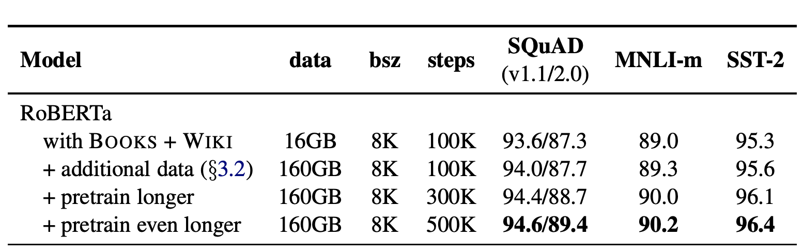

---
tasks:
- fill-mask
model-type:
- bert
domain:
- nlp
frameworks:
- pytorch
backbone:
- transformer
metrics:
- accuracy
license: Apache License 2.0
language: 
- ch
tags:
- transformer
- arxiv:1907.11692
datasets:
  train:
  - modelscope/clue
  evaluation:
  - modelscope/clue

finetune-support: True
pre-train: True
---

# 基于RoBERTa的中文Base预训练模型介绍（文档更新中）

RoBERTa的中文Base预训练模型是使用广泛的中文数据和masked language model任务训练的中文自然语言理解预训练模型。

## 模型描述

在BERT的基础之上，RoBERTa总结提出了一系列针对BERT训练的优化技术，比如更多语料、更大batch size、去除NSP任务等，从而带来稳定的效果提升，充分发挥BERT模型的潜力。详见论文[RoBERTa: A Robustly Optimized BERT Pretraining Approach](https://arxiv.org/abs/1907.11692)


本模型为Base规模（Layer-12 / Hidden-768 / Head-12)，参数规模约为102M。

## 期望模型使用方式以及适用范围
本模型主要用于中文相关下游任务微调。用户可以基于自有训练数据进行微调。具体调用方式请参考代码示例。

### 如何使用
在安装完成ModelScope-lib之后即可基于nlp_roberta_backbone_base_std进行下游任务finetune

#### 代码范例
```python
from modelscope.metainfo import Preprocessors
from modelscope.msdatasets import MsDataset
from modelscope.trainers import build_trainer
from modelscope.utils.constant import Tasks


# 通过这个方法修改cfg
def cfg_modify_fn(cfg):
    # 将backbone模型加载到句子相似度的模型类中
    cfg.task = Tasks.sentence_similarity
    # 使用句子相似度的预处理器
    cfg['preprocessor'] = {'type': Preprocessors.sen_sim_tokenizer}

    # 演示代码修改，正常使用不用修改
    cfg.train.dataloader.workers_per_gpu = 0
    cfg.evaluation.dataloader.workers_per_gpu = 0

    # 补充数据集的特性
    cfg['dataset'] = {
        'train': {
            # 实际label字段内容枚举，在训练backbone时需要传入
            'labels': ['0', '1'],
            # 第一个字段的key
            'first_sequence': 'sentence1',
            # 第二个字段的key
            'second_sequence': 'sentence2',
            # label的key
            'label': 'label',
        }
    }
    # lr_scheduler的配置
    cfg.train.lr_scheduler.total_iters = int(len(dataset['train']) / 32) * cfg.train.max_epochs
    return cfg

#使用clue的afqmc进行训练
dataset = MsDataset.load('clue', subset_name='afqmc')
kwargs = dict(
    model='damo/nlp_roberta_backbone_base_std',
    train_dataset=dataset['train'],
    eval_dataset=dataset['validation'],
    work_dir='/tmp',
    cfg_modify_fn=cfg_modify_fn)

#使用nlp-base-trainer
trainer = build_trainer(name='nlp-base-trainer', default_args=kwargs)
trainer.train()
```

### 模型局限性以及可能的偏差
基于中文数据进行训练，模型训练数据有限，效果可能存在一定偏差。

## 训练数据介绍
数据来源于[https://huggingface.co/datasets/wikipedia](https://huggingface.co/datasets/wikipedia)及内部收集的广泛中文数据

## 模型训练流程
在中文wiki等广泛中文数据无监督数据上，通过MLM任务充分训练得到。

## 数据评估及结果
暂无

### 相关论文以及引用信息
如果我们的模型对您有帮助，请您引用文章：
```BibTex
@article{liu2019roberta,
  title={Roberta: A robustly optimized bert pretraining approach},
  author={Liu, Yinhan and Ott, Myle and Goyal, Naman and Du, Jingfei and Joshi, Mandar and Chen, Danqi and Levy, Omer and Lewis, Mike and Zettlemoyer, Luke and Stoyanov, Veselin},
  journal={arXiv preprint arXiv:1907.11692},
  year={2019}
}
```
