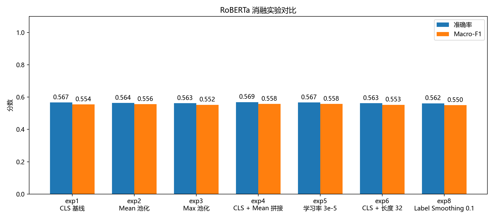
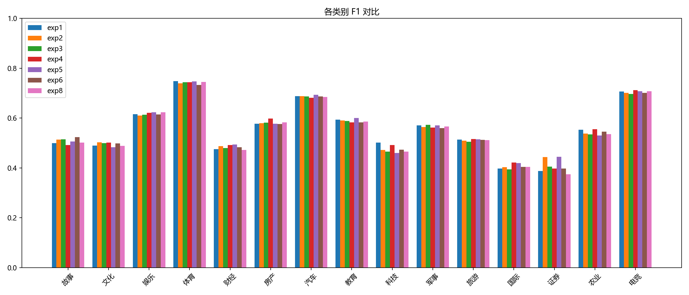
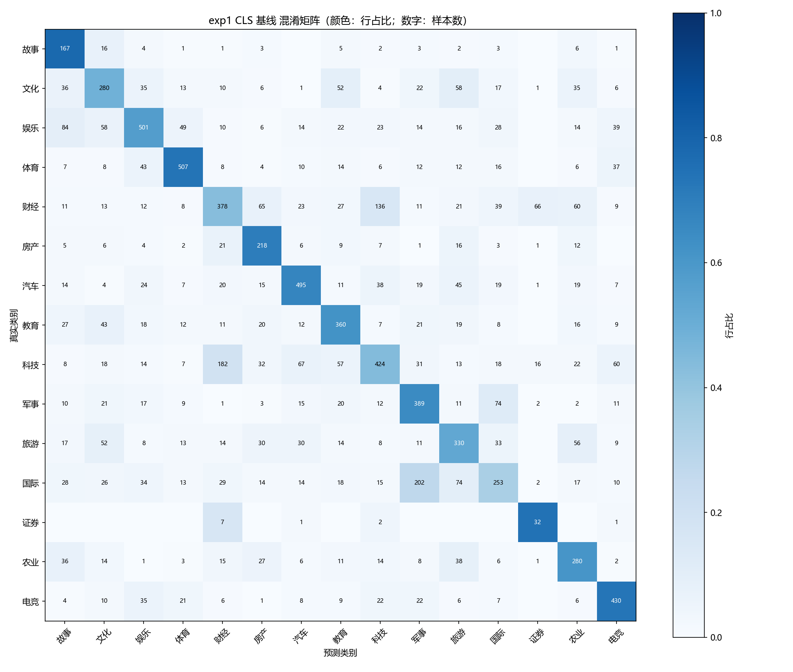
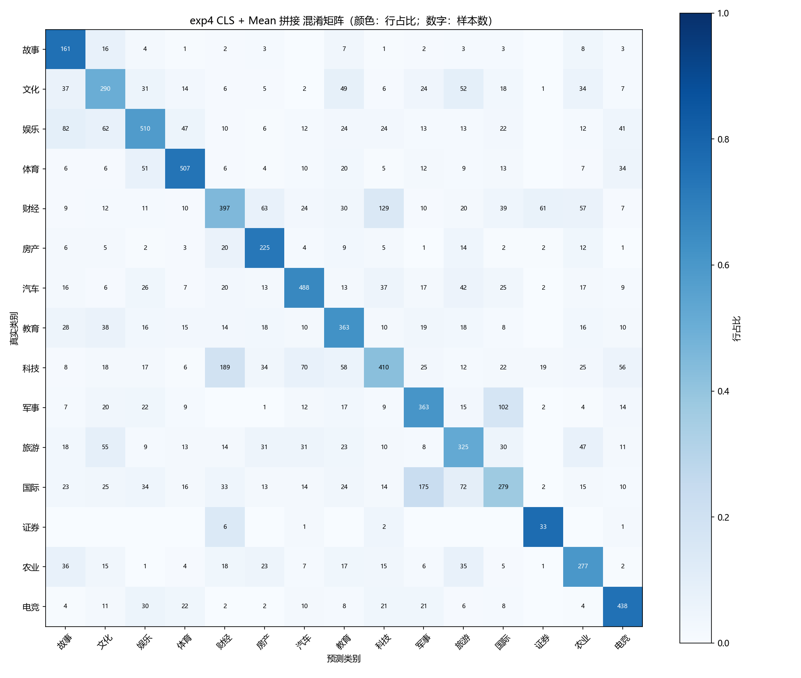
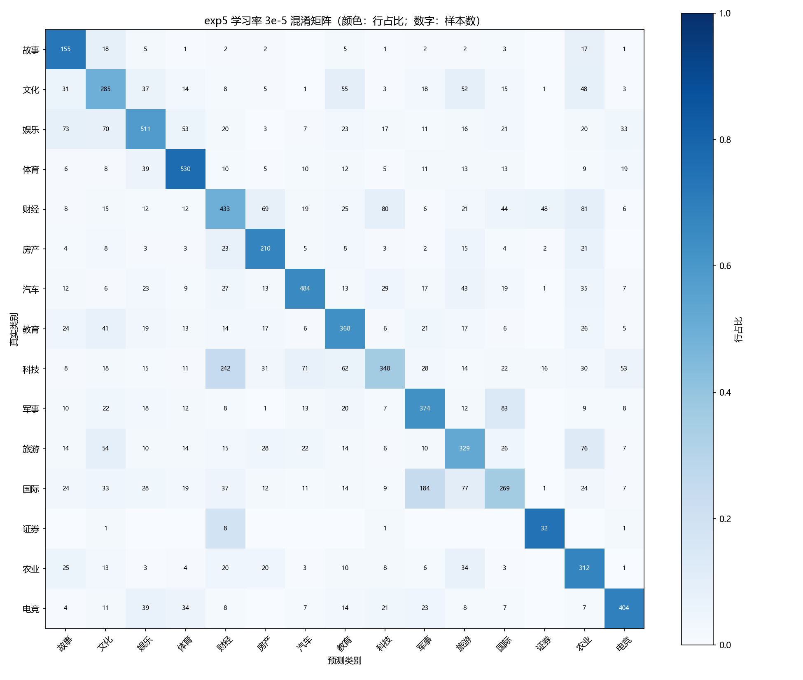
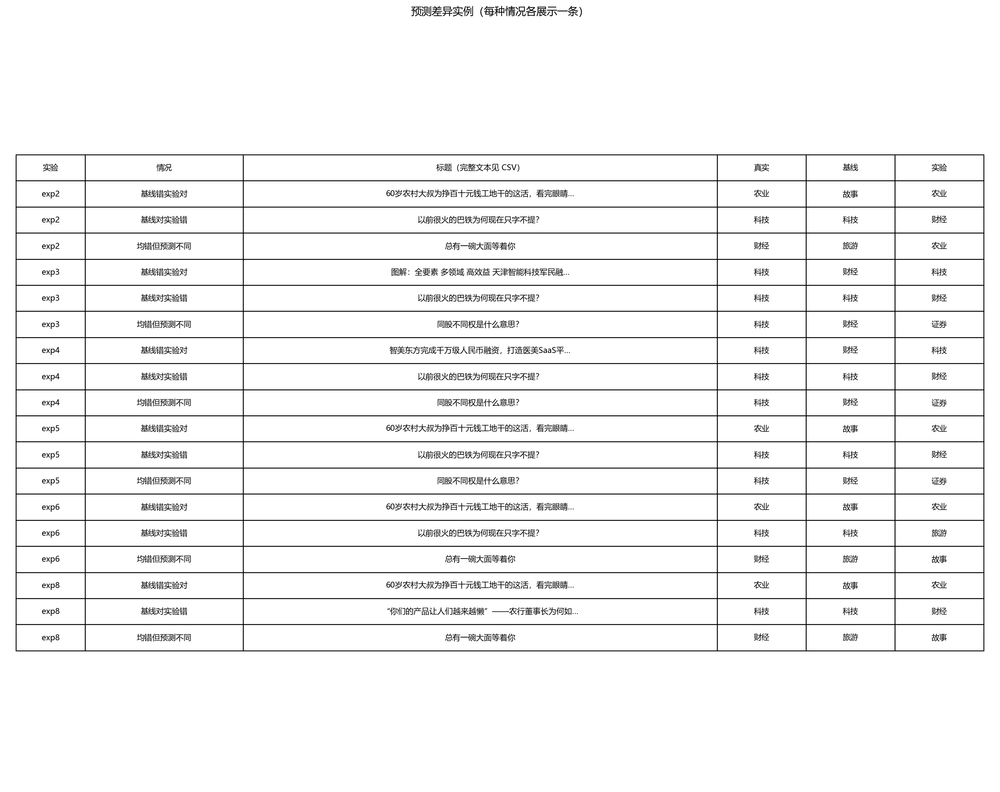

# RoBERTa 7 组消融实验报告

训练样本：53360；去重验证样本：8901；随机种子：42；每组最多 3 轮。

各组均从同一预训练模型开始，每组以去重验证集 Macro-F1 选择最佳轮次。该验证集同时用于模型选择和结果比较，结果不能当作独立测试集表现。

| 实验 | 配置 | 准确率 | Macro-F1 | 相对基线 F1（百分点） | 最佳轮次 | 耗时（分钟） |
|---|---|---:|---:|---:|---:|---:|
| exp1 | CLS 基线 | 0.5667 | 0.5545 | +0.00 | 3 | 143.5 |
| exp2 | Mean 池化 | 0.5642 | 0.5562 | +0.17 | 2 | 143.5 |
| exp3 | Max 池化 | 0.5626 | 0.5522 | -0.23 | 2 | 143.5 |
| exp4 | CLS + Mean 拼接 | 0.5691 | 0.5578 | +0.33 | 3 | 143.6 |
| exp5 | 学习率 3e-5 | 0.5667 | 0.5581 | +0.36 | 2 | 144.0 |
| exp6 | CLS + 长度 32 | 0.5626 | 0.5528 | -0.16 | 2 | 73.5 |
| exp8 | Label Smoothing 0.1 | 0.5617 | 0.5501 | -0.44 | 2 | 158.7 |

本次 Macro-F1 最佳：**exp5 学习率 3e-5**。单个随机种子的差异可能有波动，不能直接归因于配置。

## 各组混淆矩阵

### exp1 CLS 基线

### exp2 Mean 池化

### exp3 Max 池化

### exp4 CLS + Mean 拼接

### exp5 学习率 3e-5

### exp6 CLS + 长度 32

### exp8 Label Smoothing 0.1

## 预测实例

`examples.csv` 展示基线与各实验的典型差异；`prediction_comparison.csv` 保存所有评估样本的预测。

报告仅包含已完成的实验，未列出的配置没有测试。
