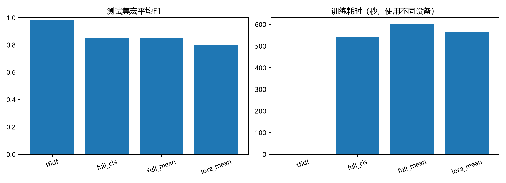
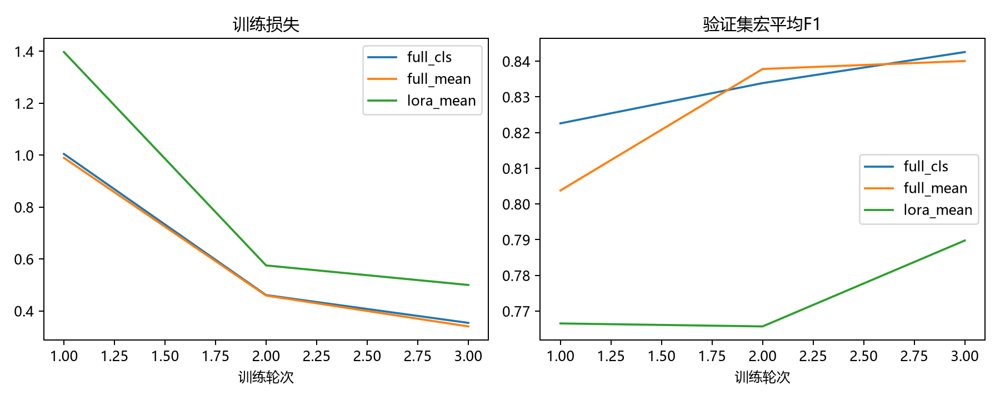

# 第六周：更换数据集后的分类方法对比

## 作业要求与实验范围

老师要求：“更换预训练模型或数据集，做分类任务各种方法的对比实验。”

本实验把课堂十五类中文新闻数据更换为十二语种识别数据，保留现有中文预训练编码器，比较传统字符分类、两种池化全参数微调和低秩适配微调。方法数量、样本量、训练轮次与评价指标是本实验选择，不是老师额外规定。结果整理完成后见 `results/` 中对应正式实验目录的 `RESULTS.md`。

## 数据与划分

数据来自第三周已有 `data/langid/v12`，由 Tatoeba（多语种例句库）语料加工。原始文件为9600条训练、1200条验证、1800条测试，字段为 `text,label`。标签顺序固定：

```text
ar en es hi ja ko pt ru th tr vi zh
```

分别对应阿拉伯语、英语、西班牙语、印地语、日语、韩语、葡萄牙语、俄语、泰语、土耳其语、越南语、中文。

保留原始划分边界，对原文做兼容规范化、忽略大小写及非字母符号去重；按照训练、验证、测试的顺序排除重复，再以种子42分层抽样。实际选取每类200/50/100条，即2400/600/1200条，所有方法样本完全相同。未把测试集加入训练，未根据测试成绩追加调参。原文规范化跨集合重叠为0；不声称已排除所有语义近重复或翻译族关联。

完整数据不随提交重新分发。来源、许可及原因见 `SUBMISSION.md`。复现者需准备课程原始三份数据；`data_audit.json` 保存源文件摘要，`split_indices.json` 保存抽样行号与内容摘要，可核对是否使用同一版本。直接重下最新版原始语料不能保证生成相同课堂加工数据。

## 基础模型与方法

基础模型为 `google-bert/bert-base-chinese`，BERT（双向编码器预训练模型）原始权重，12层、768维隐向量、21128词表。加载第四周的原始预训练目录，不使用第四或第五周微调结果。训练输出写到本周新目录，历史文件只读。

| 标识符 | 分类方式 | 更新范围 |
|---|---|---|
| `tfidf` | TF-IDF（词频逆文档频率）字符特征加线性支持向量分类器 | 线性决策系数；不使用预训练权重 |
| `full_cls` | 第一个序列标记的隐藏向量接线性分类头 | 编码器与分类头参与优化 |
| `full_mean` | 有效词元隐藏向量掩码均值接线性分类头 | 编码器与分类头参与优化 |
| `lora_mean` | 相同掩码均值，LoRA（低秩适配）旁路 | 查询和值投影的旁路及分类头，原编码器冻结 |

编码器原有池化层未被这两种池化路径调用：全参数模式的“可训练参数”按梯度开关计数，包含该未参与前向的池化层；并非每个标记为可训练的张量都有非零梯度。实验另行检查实际参与分类的注意力权重和分类头确实更新。

`lora_mean` 的低秩设置为秩8、缩放16、随机失活0.05，目标模块名是 `query` 和 `value`。适配权重采用安全张量文件保存，同时包含分类头，重新加载时需要原始基础模型。它与全参数均值方法共享结构、数据和分类头初始化，但优化范围和骨干学习率不同，不能将结果差异完全归因于参数数量。

## 重要代码的数据流

1. `prepare` 读取原始三份数据，在抽样前按规范化文本去重。输出每条原文、整数标签和源行号，同时记录实际数量与内容校验。
2. `encode` 使用原始分词器，输出词元编号、注意力掩码，均为 `[批次,64]`；标签为 `[批次]`，值域0到11。
3. `Classifier.forward` 的编码器输出 `[批次,64,768]`。首位置池化直接取位置0；均值池化用注意力掩码排除补位。线性分类头输出 `[批次,12]`，不先做归一化概率，直接交给交叉熵。
4. `run_neural` 累积两批梯度后裁剪、更新参数并推进学习率。各轮用同一验证集计算宏平均F1，严格改善时保存；最终加载所选权重再评估独立测试集。
5. `metrics` 对12类等权计算精确率、召回率及F1，同时保存12乘12混淆矩阵。准确率是全部测试样本中预测正确的比例，没有解析失败或丢弃失败样本的情况。

## 环境与训练配置

实际环境使用 `D:/Anaconda3/envs/py312/python.exe`，显卡为3050Ti笔记本显卡，4GB显存。主要依赖固定于 `requirements.txt`；精确运行版本还保存在实验 `config.json` 中。本次没有安装或升级依赖。
如需在单独准备的课程环境安装，可先从官方计算平台安装对应构建，再安装其余依赖。以下是复现说明，本次没有执行安装：

```powershell
python -I -B -m pip install torch==2.6.0+cu124 --index-url https://download.pytorch.org/whl/cu124
python -I -B -m pip install -r .\requirements.txt
```

命令须在已激活的 `py312` 课程环境执行，不要在基础环境执行。首次导入依赖在本机可能耗时较长，训练输出目录创建后才开始训练准备。

| 参数 | 配置 |
|---|---|
| 神经训练轮次 | 3，每轮300次参数更新，共900次 |
| 每批样本数 / 梯度累积 | 4 / 2，有效每批8条 |
| 序列上限 | 64词元 |
| 全参数编码器学习率 | 2e-5 |
| 低秩旁路学习率 | 2e-4 |
| 三种神经分类头学习率 | 1e-4 |
| 优化器 | AdamW（带解耦权重衰减的自适应优化器），衰减0.01 |
| 调度 | 前10%更新预热，随后线性衰减 |
| 精度与显存控制 | 支持时采用脑浮点十六位混合精度；梯度检查点；梯度范数上限1 |
| 分类头随机失活 | 0.1 |
| 模型选择 | 验证宏平均F1最高，平分保留较早轮次 |
| 传统方法 | 字符1—2元，最多300000维，正则参数1.0 |

训练耗时统计神经方法的训练循环及同步，不含各轮验证、模型加载和存盘；另记录总流程耗时。传统方法计时包括特征拟合和线性分类器拟合。两者设备不同，不能把时间倍数当作严格硬件公平测量。参数量统计口径也不同：传统方法是线性系数，未计词典与逆文档频率数组；神经方法是张量参数。

## 训练、测试与推理指令

在 `D:/Project/Lesson` 使用课程环境执行：

```powershell
& "D:\Anaconda3\envs\py312\python.exe" -I -B .\week06\test_comparison.py
& "D:\Anaconda3\envs\py312\python.exe" -I -B .\week06\compare_classifiers.py --smoke
& "D:\Anaconda3\envs\py312\python.exe" -I -B .\week06\compare_classifiers.py --epochs 3
```

第三条执行完整四方法实验，终端有训练进度条。每次自动创建不同时间戳目录，不覆盖已有实验。小规模模式每个神经方法只更新3次，使用验证小样本，不输出正式测试成绩。

单独运行一种方法或在提交后的独立目录中复现：

```powershell
python -I -B .\compare_classifiers.py --methods full_mean --epochs 3 --data-dir "D:\Project\Lesson\week03\data\langid\v12" --model-dir "D:\Project\Lesson\week04\bert-base-chinese"
```

以上简写 `python` 的前提是已经激活课程 `py312` 环境。程序默认离线加载，不自动下载资源；需要能运行所列依赖的课程显卡环境。`experiment_settings.json` 用于说明实际固定参数，不是自动读取的参数覆盖入口。
汇总与最终交付验收工具针对默认的四方法、三轮完整比较实验；单方法实验可直接读取其 `result.json` 和 `history.json`，不应套用要求四项成绩齐全的交付验收。

训练结束后，将下列命令的目录参数换成实际输出目录：

```powershell
python -I -B .\week06\report_results.py --run .\week06\experiments\formal_20261119_162423
python -I -B .\week06\infer_classifier.py --run .\week06\experiments\formal_20261119_162423 --method tfidf --text "今天天气很好。"
python -I -B .\week06\infer_classifier.py --run .\week06\experiments\formal_20261119_162423 --method full_mean --evaluate
python -I -B .\week06\verify_delivery.py --run .\week06\experiments\formal_20261119_162423
```

推理只读加载本地最佳权重。传统分类器文件只应加载本地可信训练产物。迁移机器时神经推理可用 `--model-dir` 指定新的原始模型路径。公开模型来源为 [模型卡](https://huggingface.co/google-bert/bert-base-chinese)，需自行准备权重及分词文件；源权重校验值见实验配置。

最终验收工具要求本地保留原始材料与 `materials_inventory.json`，因为需要校验材料未改动；它不属于重新训练的必要步骤。提交副本不含原始材料清单时，先在原 Lesson 目录执行最终验收，再复制允许清单。主要训练和推理工具不依赖这份清单。

## 结果与分析

正式实验目录为 `formal_20261119_162423`。三种神经方法都实际完成900次更新，均由第三轮取得最高验证宏平均F1；下表来自重载最佳模型后的同一1200条独立测试集。

| 方法 | 准确率 | 宏平均精确率 | 宏平均召回率 | 宏平均F1 | 训练秒数 | 可训练参数 | 峰值分配显存MiB |
|---|---:|---:|---:|---:|---:|---:|---:|
| 字符加权特征与线性分类 | 98.25% | 0.9827 | 0.9825 | 0.9825 | 0.32 | 169104 | 0（未使用显卡） |
| 首位置全参数微调 | 84.83% | 0.8669 | 0.8483 | 0.8468 | 540.65 | 102276876 | 1960.5 |
| 均值全参数微调 | 85.25% | 0.8684 | 0.8525 | 0.8506 | 601.45 | 102276876 | 1960.5 |
| 均值低秩适配 | 81.17% | 0.8187 | 0.8117 | 0.8000 | 563.94 | 304140 | 450.1 |





**本次任务优先选择传统字符分类。** 它效果最好、训练资源开销最低。语种识别有较强字符与局部拼写线索，原始字符特征能够保留这些线索；本次中文预训练模型则不适合覆盖全部语种。这是本数据、本预算下的结论，不能推广成传统方法在中文语义分类中也必然更强。

均值全参数微调比首位置池化准确率高0.4167个百分点、宏平均F1高约0.00376。差距较小，只能说明这次运行的排序，未运行多种子检验，不能声称均值池化具有稳定优势。

低秩适配可训练参数约为全参数模式的0.297%，峰值分配显存降低约77.0%，但宏平均F1也较均值全参数微调低约0.0506。其训练时间仍为563.94秒：冻结基础权重不会消除编码器前向和梯度传播成本，参数量减少不等于训练耗时同比减少。不同方法的骨干学习率有差异，不能将全部差异单独归因为低秩约束。

**实际错误与可能原因：** 传统分类共错21条，其中西班牙语误判葡萄牙语7条，反向6条，两者合计13条；相近拼写结构是合理解释。均值全参数模型有41条越南语被判成韩语，而越南语召回率只有0.48；该模型西班牙语与葡萄牙语互相误判共40条。低秩方法的葡萄牙语召回率为0.29、越南语0.44、土耳其语0.56，说明整体准确率不足以描述各类效果。

训练集的未知词元比例在印地语为94.36%、泰语92.77%、韩语83.65%、越南语69.07%，中文为0.31%。不同原文压缩后出现57种训练与测试共享输入序列，原文重叠仍为0。词表压缩可能解释部分神经方法错误，但部分高未知比例语种依然较容易区分；句长、已知片段等信号仍可能有效。未做多语种基座对照，因此这些原因分析属于推测，不是已证明的因果结论。

**过拟合与模型质量：** 两种全参数微调的第三轮训练损失继续下降，验证损失分别从第二轮0.4682升至0.5075、从0.4627升至0.5155，而验证宏平均F1略升。这是过度自信或过拟合风险信号，不能宣称完全没有过拟合。模型仍按预先确定的验证宏平均F1选择，没有查看测试结果后追加训练。低秩方法的验证损失三轮持续下降，但这同样不能证明未来不会过拟合。

完整逐类召回见 `per_class.csv`，错误标签对及原始行号摘要见 `error_analysis.json`，混淆矩阵见对应图片。行号从0开始，不含原始表头。实际单句推理已验证：传统方法输入“今天天气很好。”输出 `zh`（中文）。

## 测试与局限

- 已通过规范化去重键、已知宏平均指标、补位位置不参与均值池化的三个独立行为测试。
- 已通过四方法小规模训练检查，三个神经方法各更新3次，检查有限损失与梯度、目标参数和分类头实际变化；低秩方法检查冻结参数探针保持不变；四方法都完成保存重载。
- 模型加载提示原预训练任务头未使用，是从预训练模型提取编码器时的预期差异。
- 中文预训练模型的词表并不覆盖全部十二语种。分词会丢失信息，因此不能从本次比较推断所有多语种预训练模型的效果。
- 只运行一个随机种子、一次有限规模正式实验；未测置信区间、跨设备延迟、域外语料或多语种基座。未证明全局最优，也不能以有限验证表现证明未来不会过拟合。

