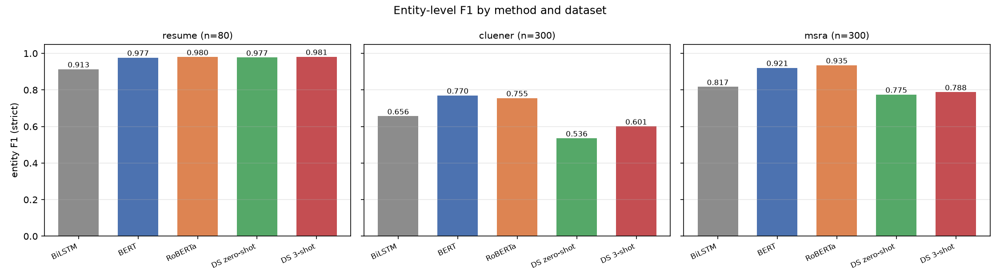

# 第七周作业：中文信息抽取（NER）方法对比

> 同一抽取任务，换 **模型**（BiLSTM-CRF / BERT / 中文 RoBERTa）、换 **API**（DeepSeek zero-shot / few-shot）、
> 换 **数据集**（简历合成 / CLUENER2020 / MSRA），用**同一套评测口径**回答一个问题：
> **不同方法的差距到底在哪，代价差多少，换个数据集排位会不会翻。**

- 规划：[PLAN.md](PLAN.md)（编码前定稿，含 RQ、实验矩阵、时间预算）
- 结果：[REPORT.md](REPORT.md)（分析）、[reports/RESULTS.md](reports/RESULTS.md)（自动生成的总表）
- 数据概况：[data/processed/DATA.md](data/processed/DATA.md)
- 过程记录：[worklog-20261125-1317-week07-ner-benchmark.md](worklog-20261125-1317-week07-ner-benchmark.md)（执行日志 + 阅读路线 + 问题本质 + 自测题）
- 项目地图：[PROJECT-MAP.md](PROJECT-MAP.md)（术语、模块职责、已知的坑）

---

## 1. 任务与数据

任务：字符级序列标注（BIO），输入中文文本，输出所有实体的 `(start, end, label)`。

| 数据集 | 来源 | 领域 | 标签数 | train/dev/test | 角色 |
| --- | --- | --- | ---: | --- | --- |
| resume | 本项目模板合成（seed=42，无隐私） | 简历 | 10 | 500 / 60 / 80 | 小样本 + 模板化 |
| cluener | CLUEbenchmark/CLUENER2020 公开集 | 泛领域 | 10 | 8600 / 1074 / 1074 | 真实人工标注、细粒度 |
| msra | MSRA NER（BIO 版） | 新闻 | 3 | 10000 / 1000 / 1000 | 大规模、粗粒度 |

三套数据标签体系不同，因此只做「同数据集内方法对比」，不做跨数据集迁移。

> CLUENER 官方 test.json 是盲测集（无 label），所以从官方 train 重新切了 8600/1074/1074；
> 官方 dev 未使用。MSRA 原始 4.5 万句，按固定 seed 抽 1 万训练。

## 2. 方法

| 方法 | 说明 | 训练 |
| --- | --- | --- |
| BiLSTM-CRF | 字符向量 128 + BiLSTM 256 + CRF；词表只用 train | 是 |
| BERT | `bert-base-chinese` 微调，按 dev F1 存 best | 是 |
| RoBERTa | `hfl/chinese-roberta-wwm-ext`（结构是 BERT，预训练目标是 RoBERTa） | 是 |
| DeepSeek zero-shot | `deepseek-chat`，temperature=0，只输出 JSON | 否 |
| DeepSeek 3-shot | 同上 + 3 条 train 示例（不碰 dev/test） | 否 |

统一细节：子词对齐用 `offset_mapping`（首子词 B-、后续 I-）；LLM 只输出原文片段，程序用 `text.find()` 回填 offset。

## 3. 快速开始

```powershell
# 0) 环境
conda activate py312
pip install -r requirements.txt

# 1) API key（只读环境变量，不写进任何文件）
$env:DEEPSEEK_KEY = "sk-..."

# 2) 数据（CLUENER 走 Google Storage，MSRA 走 jsdelivr，均已验证可直连）
python scripts/download_data.py
python scripts/prepare_data.py --datasets resume cluener msra
python scripts/data_stats.py

# 3) 基座（走 hf-mirror，约 800MB）
python scripts/download_models.py

# 4) 一键跑完（已跑过的会自动跳过）
python scripts/run_all.py

# 5) 补充分析：截断率、书名号口径、排位、逐句 bad case
python scripts/analysis.py
python scripts/badcases.py --dataset cluener
python scripts/dump_configs.py
```

只重跑某一格：

```powershell
python -m src.train_bilstm --dataset cluener --epochs 15
python -m src.train_transformer --dataset cluener --model roberta --epochs 5 --max_len 128
python -m src.llm_extract --dataset cluener --mode few --n 300
```

## 4. 目录结构

```text
week07/
├─ PLAN.md / README.md / REPORT.md
├─ requirements.txt
├─ configs/                      # 每个实验实际用的超参（由 dump_configs.py 生成）
├─ data/
│  ├─ raw/                       # CLUENER zip、MSRA BIO
│  └─ processed/<dataset>/       # train/dev/test.jsonl、labels.json、stats.json、validation.json
├─ models/                       # bert/ roberta/（下载后离线加载）
├─ src/
│  ├─ common.py                  # 路径、日志、seed、JSON
│  ├─ data.py                    # BIO 互转、词表、两套 Dataset
│  ├─ metrics.py                 # 统一评测 + 错误归因
│  ├─ gen_resume.py              # 简历合成数据
│  ├─ bilstm_crf.py              # 模型 + 手写 CRF（已用暴力枚举对拍）
│  ├─ train_bilstm.py
│  ├─ train_transformer.py       # BERT / RoBERTa 共用
│  ├─ llm_extract.py             # DeepSeek zero/few-shot + 容错解析
│  ├─ evaluate_pred.py           # 任意 pred.jsonl → 统一指标
│  └─ compare.py                 # 汇总表 + 5 张图
├─ scripts/                      # download_data / prepare_data / data_stats / selftest / run_all / analysis
├─ outputs/<dataset>/<method>/   # 权重、pred.jsonl、metrics.json、日志
└─ reports/                      # RESULTS.csv / RESULTS.md / ANALYSIS.md / cases_*.md / figures/
```

## 5. 结果

见 [reports/RESULTS.md](reports/RESULTS.md)（全量 15 行）与 [REPORT.md](REPORT.md)（分析）。

**同一批测试样本上的 entity-F1（LLM 抽样 300 条，有监督模型同批重算）**

| 方法 | resume (80) | cluener (300) | msra (300) |
| --- | ---: | ---: | ---: |
| BiLSTM-CRF | 0.9135 | 0.6565 | 0.8168 |
| BERT | 0.9767 | **0.7699** | 0.9211 |
| RoBERTa | 0.9801 | 0.7554 | **0.9352** |
| DeepSeek zero-shot | 0.9771 | 0.5357 | 0.7748 |
| DeepSeek 3-shot | **0.9813** | 0.6009 | 0.7881 |

三句话：模板数据上 LLM 追平微调模型；真实细粒度数据上微调领先 14 个点；粗标签短句上 BiLSTM 与 LLM 打平。
（LLM 在 CLUENER 上的一半差距来自「书名号算不算实体」的标注口径，见 REPORT §4.2。）



## 6. 评测口径（为什么这些数字可信）

1. **实体级严格匹配**：`(start, end, label)` 完全一致才算 TP（等价 seqeval strict）。
2. **自检**：gold 当 pred 跑，三个数据集 F1 都必须 = 1.0000；BIO 往返必须无损（`scripts/selftest.py`）。
3. **同批对比**：LLM 只抽样 300 条，有监督模型在同一批 id 上重算一份（`metrics_subset.json`），表里的「F1(同批)」才是可比的。
4. **固定 seed**：数据生成、切分、抽样、训练全部 seed=42；抽样 id 落盘。
5. **错误归因**：漏掉的实体分「类型错 / 边界错 / 两类都错 / 完全没检出」，避免只看总分。

## 7. 已知局限

- 简历数据是模板合成，指标偏乐观；报告里单列了 hard 子集（未见版式）。
- CLUENER 官方 test 无标签，重新切分后的测试集与公开榜单数字不可直接比较。
- LLM 只抽 300 条（受费用/时间限制），置信区间约 ±2 个点。
- 只做了 zero/few-shot，没有做 LoRA/全参 SFT（不在本次问题范围内）。
