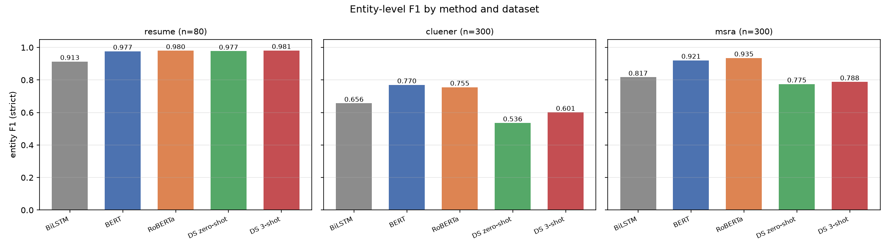

# 第七周实验报告：中文 NER 的五种做法，差在哪、差多少

> 任务：字符级实体抽取（BIO）｜数据集：resume / CLUENER2020 / MSRA
> 方法：BiLSTM-CRF、BERT、中文 RoBERTa、DeepSeek zero-shot、DeepSeek 3-shot
> 口径：实体级严格匹配（等价 seqeval strict），seed=42；LLM 抽样的 id 落盘，其他方法在同批 id 上重算

---

## 0. 一句话结论

**换数据集会把方法排位整个翻过来。** 在模板化的简历数据上，DeepSeek 零样本（0.977）追平微调 BERT（0.977）、三样本（0.981）略高于 RoBERTa（0.980）；换到人工标注的 CLUENER，同一个模型掉到 0.536 / 0.601，被微调 BERT 拉开 14 个点；再到粗粒度、句子短的 MSRA，DeepSeek（0.775 / 0.788）已经接近无预训练的 BiLSTM（0.817），但仍比 RoBERTa 低 15 个点。
**所以「哪个方法更好」这句话必须带数据集说。**

---

## 1. 实验设置

### 1.1 数据

| 数据集 | 来源 | 域 | 标签 | train/dev/test | 平均字数 | 实体/条 | 难例 |
| --- | --- | --- | ---: | --- | ---: | ---: | --- |
| resume | 模板合成（seed=42，无隐私） | 简历 | 10 | 500 / 60 / 80 | 337 | 13.4 | test 40% |
| cluener | CLUENER2020 官方公开集 | 泛领域短句 | 10 | 8600 / 1074 / 1074 | 37 | 2.2 | — |
| msra | MSRA NER（BIO） | 新闻 | 3 | 10000 / 1000 / 1000 | 53 | 2.7 | — |

三点说明：

1. **CLUENER 官方 test 是盲测集（无 label）**，所以从官方 train 重新切 8600/1074/1074，官方 dev 不用。本报告数字**不能**和公开榜单直接比。
2. **MSRA 从 4.5 万句里按 seed 取 1 万训练**；`max_len=256` 时测试集仅 0.3% 的句子、0.97% 的实体被截断（`reports/ANALYSIS.md`）。
3. **简历数据自己生成**（`src/gen_resume.py`）：10 类字段、三种版式、难例扰动（全角电话、大写邮箱、“至”连接、多余空格），槽位池按 split 切分，train/dev/test 不共享人名/学校/公司字符串。

### 1.2 方法

| 方法 | 结构 / 模型 | 训练 | 关键超参 |
| --- | --- | --- | --- |
| BiLSTM-CRF | char emb 128 + BiLSTM 256 + 手写 CRF | 是 | Adam 1e-3，batch 64，按 dev F1 早停 |
| BERT | `bert-base-chinese` + 线性头 | 是 | lr 2~3e-5，3~6 epoch，fp16 |
| RoBERTa | `hfl/chinese-roberta-wwm-ext`（结构是 BERT） | 是 | 与 BERT 完全相同 |
| DeepSeek zero-shot | `deepseek-chat`，temperature=0 | 否 | max_tokens 512，只输出 JSON |
| DeepSeek 3-shot | 同模型 + 3 条 train 示例 | 否 | 示例优先短句、标签组合不同 |

公平性控制：

- **标签映射唯一来源**：BIO 表由 `labels.json` 生成，训练/推理共用。
- **子词对齐只实现一次**：`offset_mapping` + `word_ids`，首子词 `B-`、后续 `I-`，特殊符 `-100`。
- **LLM 不算 offset**：只输出原文片段，程序用 `text.find()` 回填（生成式模型数下标不可靠）。
- **同批对比**：LLM 受费用限制只抽 300 条；有监督模型在同一批 id 上重算 `metrics_subset.json`，表里的「F1(同批)」才可比。
- **两个预训练模型同超参**，不做逐模型调参（避免把「调参」当成「模型差异」）。

### 1.3 评测自证

`scripts/selftest.py`：gold 当 pred 必须 F1=1.0000；BIO 往返必须无损；标签随机打乱后 F1 必须显著下降。

```text
resume   gold=pred F1=1.0000  BIO 往返不一致 0 条  打乱标签 F1=0.1160
cluener  gold=pred F1=1.0000  BIO 往返不一致 0 条  打乱标签 F1=0.1008
msra     gold=pred F1=1.0000  BIO 往返不一致 0 条  打乱标签 F1=0.3250
```

手写 CRF 也单独对拍过：随机小序列上，CRF 的 NLL 与暴力枚举所有路径一致（5.936968 vs 5.936968），Viterbi 解码与穷举最优路径完全一致。

---

## 2. 主结果

> 数字来自 `reports/RESULTS.csv`；「F1(同批)」= 在 LLM 抽样的 300 条（resume 为全量 80 条）上重算。
> 对 n=300 的子集，1 条样本 ≈ 0.3pp，**1.5pp 以内的差距不应过度解读**。

| 数据集 | 方法 | n | P | R | F1(同批) | F1(全量) | 参数量 | 训练 | 延迟 | 费用 |
| --- | --- | ---: | ---: | ---: | ---: | ---: | ---: | ---: | ---: | ---: |
| resume | BiLSTM-CRF | 80 | 0.9292 | 0.8983 | 0.9135 | 0.9135 | 0.9M | 61s | 7.9ms | — |
| resume | BERT | 80 | 0.9754 | 0.9781 | 0.9767 | 0.9767 | 101.7M | 15s | 8.8ms | — |
| resume | RoBERTa | 80 | 0.9782 | 0.9819 | **0.9801** | 0.9801 | 101.7M | 44s | 8.9ms | — |
| resume | DeepSeek zero-shot | 80 | 0.9605 | 0.9943 | 0.9771 | 0.9771 | — | — | 1354ms | ¥0.224 |
| resume | DeepSeek 3-shot | 80 | 0.9634 | 1.0000 | **0.9813** | 0.9813 | — | — | 1355ms | ¥0.389 |
| cluener | BiLSTM-CRF | 300 | 0.6836 | 0.6314 | 0.6565 | 0.6429 | 1.3M | 130s | 1.0ms | — |
| cluener | BERT | 300 | 0.7392 | 0.8032 | **0.7699** | 0.7385 | 101.7M | 140s | 1.4ms | — |
| cluener | RoBERTa | 300 | 0.7225 | 0.7915 | 0.7554 | 0.7418 | 101.7M | 139s | 1.4ms | — |
| cluener | DeepSeek zero-shot | 300 | 0.5684 | 0.5066 | 0.5357 | 0.5357 | — | — | 790ms | ¥0.244 |
| cluener | DeepSeek 3-shot | 300 | 0.5858 | 0.6167 | 0.6009 | 0.6009 | — | — | 765ms | ¥0.332 |
| msra | BiLSTM-CRF | 300 | 0.8437 | 0.7916 | 0.8168 | 0.8114 | 1.3M | 334s | 1.6ms | — |
| msra | BERT | 300 | 0.9249 | 0.9173 | 0.9211 | 0.9320 | 101.7M | 297s | 5.8ms | — |
| msra | RoBERTa | 300 | 0.9464 | 0.9243 | **0.9352** | 0.9461 | 101.7M | 298s | 5.7ms | — |
| msra | DeepSeek zero-shot | 300 | 0.8071 | 0.7451 | 0.7748 | 0.7748 | — | — | 786ms | ¥0.244 |
| msra | DeepSeek 3-shot | 300 | 0.8088 | 0.7683 | 0.7881 | 0.7881 | — | — | 798ms | ¥0.320 |



**排位（同批 F1）**

| 数据集 | 1 | 2 | 3 | 4 | 5 |
| --- | --- | --- | --- | --- | --- |
| resume | DS 3-shot 0.981 | RoBERTa 0.980 | DS zero 0.977 | BERT 0.977 | BiLSTM 0.913 |
| cluener | BERT 0.770 | RoBERTa 0.755 | BiLSTM 0.657 | DS 3-shot 0.601 | DS zero 0.536 |
| msra | RoBERTa 0.935 | BERT 0.921 | BiLSTM 0.817 | DS 3-shot 0.788 | DS zero 0.775 |

---

## 3. 分问题讨论

### RQ1：同数据集下，三个有监督模型差多少？

| 数据集 | BiLSTM-CRF | BERT | RoBERTa | 预训练带来的增益 |
| --- | ---: | ---: | ---: | --- |
| resume | 0.9135 | 0.9767 | 0.9801 | **+6.3 / +6.7 pp** |
| cluener | 0.6429 | 0.7385 | 0.7418 | **+9.6 / +9.9 pp** |
| msra | 0.8114 | 0.9320 | 0.9461 | **+12.1 / +13.5 pp** |

（用全量测试集，避免子集噪声。）

- 预训练的价值随数据量、标签粒度放大：500 条模板数据只值 6 个点，1 万条真实数据值 12 个点。
- **RoBERTa 在三个数据集上都略高于 BERT（+0.34 / +0.33 / +1.41）**，方向一致但幅度很小；CLUENER 的 0.3pp 完全在子集噪声内（同批 300 条上 BERT 反而高 1.4pp）。
- BiLSTM 只有 0.9~1.3M 参数（比 BERT 小约 80 倍），代价是**召回与边界一起掉**：CLUENER 上 R 0.631 vs BERT 0.803，F1 差 9.6pp；MSRA 上 R 0.796 vs 0.937，F1 差 12.1pp。

### RQ2：换数据集，方法排位会不会翻？

会，而且是两次翻转：

1. **模板数据 → 真实数据**：所有方法都掉，但 LLM 掉得最狠（0.977 → 0.536），有监督模型掉得少（BERT 0.977 → 0.738）。说明**模板数据严重高估生成式方法**：简历的字段是「姓名/电话/邮箱」这种世界知识，LLM 零样本本来就会；而 CLUENER 的「景点/游戏/书名」需要域内标注口径。
2. **细粒度 10 类 → 粗粒度 3 类**：LLM 与最好有监督模型的差距几乎没变（CLUENER 16.9pp → MSRA 14.7pp，同批口径），但**它与 BiLSTM 的差距从 5.6pp 缩到 2.9pp**。翻的不是 LLM 的位置，而是 BiLSTM 的位置：标签越粗、句子越短，无预训练模型越接近 LLM。

**结论**：数据集换了，比的其实是三件不同的事——世界知识（resume）、细粒度类型体系（CLUENER）、边界与长尾（MSRA）。这也是为什么单榜排名不可迁移。

### RQ3：不训练直接调 API，能打到几成？

| 数据集 | DS zero | DS 3-shot | 最好的有监督 | 差距 | 3-shot 相对最好 |
| --- | ---: | ---: | ---: | --- | ---: |
| resume | 0.9771 | 0.9813 | RoBERTa 0.9801 | **+0.1pp（反超）** | 100% |
| cluener | 0.5357 | 0.6009 | RoBERTa 0.7418 | **−14.1pp** | 81% |
| msra | 0.7748 | 0.7881 | RoBERTa 0.9461 | **−15.8pp** | 83% |

- **few-shot 的收益不稳定**：CLUENER +6.5pp（类型体系复杂，例子有用），MSRA +1.3pp，resume +0.4pp（本来就会）。代价是 prompt token +31%~74%、费用 +31%~74%。
- **零样本的失败模式是「保守」**：CLUENER 上只输出 607 个实体（金标 681，−11%），MSRA 793/859（−7.7%）；三样本后变成轻微过度输出（717、816）。也就是说 zero-shot 主要输在召回，few-shot 把召回买回来、但精确率不升。
- **JSON 合法率 100%、幻觉片段 0~1 条**（`text.find()` 找不到的片段）：DeepSeek 的指令跟随在这三个数据集上没有成为瓶颈，差距全部来自「抽得对不对」。

### RQ4：各方法的错误结构一样吗？

以 CLUENER 的同批 300 条为例（漏掉的每个金标实体归一类，分母=该方法的 FN 总数）：

| 方法 | 总 FN | 类型错 | 边界错 | 两类都错 | 完全没检出 |
| --- | ---: | ---: | ---: | ---: | ---: |
| BiLSTM-CRF | 251 | 20% | 33% | 8% | **39%** |
| BERT | 134 | 22% | 44% | 8% | 25% |
| DeepSeek zero-shot | 336 | 12% | 32% | 8% | **48%** |
| DeepSeek 3-shot | 261 | 18% | **46%** | 10% | 26% |

- 有监督模型（尤其 BiLSTM）**大量「完全没检出」**：BiLSTM 39% 的漏标是彻底没标，BERT 靠预训练把它压到 25%，但边界错升到 44%——它敢标了，只是标多/标少。
- **零样本 LLM 的最大问题也是漏检（48%）**，和它「宁缺毋滥」的输出风格一致（CLUENER 只输出 607 个实体，金标 681）。三样本把漏检压到 26%，但边界错涨到 46%，和 BERT 的错误结构几乎一模一样。
- 所以 few-shot 买到的主要是**召回**，不是精确率：LLM 的 P 从 0.568 只升到 0.586。
- LLM 的边界错有明确模式：`《美丽的魂魄》` 写成 `美丽的魂魄`、`招商银行` 标成 organization 而不是 company（类型体系歧义）。

### RQ5：精度之外，代价差多少？

| 维度 | BiLSTM-CRF | BERT / RoBERTa | DeepSeek API |
| --- | --- | --- | --- |
| 参数量 | 0.9~1.3M | 101.7M | 未公开（按 token 计费） |
| 训练成本 | 61~334s（单卡 3060Ti） | 15~298s | 0 |
| 推理延迟 | 1.0~1.6ms/句 | 1.4~8.9ms/句 | **765~1355ms/句** |
| 边际成本 | ≈0 | ≈0 | resume ¥0.22~0.39 / 80 句（**¥2.8~4.9/千句**）；CLUENER/MSRA ¥0.24~0.33 / 300 句（**¥0.8~1.1/千句**） |
| 换 schema | 要重训 | 要重训 | **改 prompt 即可** |

延迟差 **100~800 倍**；费用差在「一次性训练」与「按量付费」之间。数据量小、schema 常改、要求离线/隐私 → 本地微调；数据量大、吞吐要求高、标签固定 → 微调更划算；一次性抽取、schema 未定 → API 更划算。

---

## 4. 错误分析

### 4.1 最反直觉的一组数：resume 的 hard 子集

简历测试集里 32/80 条是难例（未见版式：全角电话、大写邮箱、“至”连接、多余空格）。整体 F1 上 LLM 与 BERT 打平，但**难例上门槛完全不同**：

| 方法 | 整体 F1 | hard 子集 F1 |
| --- | ---: | ---: |
| BiLSTM-CRF | 0.9135 | 0.7848 |
| BERT | 0.9767 | 0.9443 |
| RoBERTa | 0.9801 | 0.9493 |
| DeepSeek zero-shot | 0.9771 | 0.9807 |
| DeepSeek 3-shot | 0.9813 | **0.9868** |

解释：有监督模型是从 500 条模板里**归纳出了「冒号+全角空格」这类表面模式**，版式一变就掉；LLM 靠的是「姓名/电话/邮箱长什么样」的语义先验，反而更稳。**如果只看整体 F1，会得出「两者一样」的错误结论。**

具体例子（`reports/cases_resume.md`，resume-test-000014）：同一份简历里电话写成全角 `１７２６８７４４７０１`、邮箱全大写 `ZHOUJIE25@SINA.COM`。RoBERTa 把全角电话整段漏掉，BERT 和 DeepSeek 都命中——这类样本在训练集里一条都没有，考的是「没见过也要认得出」。

### 4.2 书名号：10 个点埋在标注口径里

CLUENER 的金标把书名/电影名连书名号一起标（`《读者》`），而 LLM 习惯只输出里面的文字（`读者`）。严格匹配下这全算错：

- CLUENER 测试集带书名号/引号的实体占 12.6%（303/2410）。
- 我人工核对了 LLM 在 book/movie 上的 62 个错误：**40 个（65%）只差书名号**，4 个是类型错，11 个是真漏。
- 把 gold 和 pred 两边同时去掉首尾书名号再评（同批 300 条）：LLM 从 **0.6009 → 0.7024（+10.2pp）**，BERT 只从 0.7699 → 0.7782（+0.8pp）。

也就是说，**LLM 与 BERT 在 CLUENER 上的差距，一半以上是「标注约定 vs 生成习惯」的口径差，不是抽取能力差**。这类差异在有监督模型上几乎不存在（它从金标里学会了带书名号）。正式表仍用 strict，不做放水；但报数字时必须说明口径。

典型样例（`reports/cases_cluener.md`）：

```text
金标：government「比利时电影局」 government「香港艺术发展局」 movie「《美丽的魂魄》」 address「香港」
LLM ：government「比利时电影局」 government「香港艺术发展局」 movie「美丽的魂魄」      ← 少了书名号
```

### 4.3 类型体系越细，LLM 越吃力

CLUENER 各类 F1（同批 300 条）：

| 类型 | BERT | DeepSeek 3-shot | 说明 |
| --- | ---: | ---: | --- |
| name | 0.883 | 0.883 | 世界知识，LLM 完全不输 |
| game | 0.823 | 0.490 | 需要「这是游戏名」的域内判断 |
| company | 0.795 | 0.759 | 接近 |
| organization | 0.781 | 0.672 | 「希洪」是球队还是组织？标注口径细 |
| position | 0.692 | **0.431** | LLM 只召回 31%，大量职位没标 |
| address | 0.627 | 0.443 | 地址边界（省市要不要连着）分歧大 |
| movie | 0.794 | **0.067** | 书名号 + 类型双重问题 |
| book | 0.847 | 0.172 | 同上 |

结论：**LLM 的强项是「实体长什么样」，弱项是「这个实体属于你定义的哪一类」**；标签体系越细、越依赖标注约定，微调越占优。

### 4.4 长度与截断

- resume 最长 394 字、CLUENER 50 字，均在 `max_len` 内，无截断。
- MSRA `max_len=256` 时测试集 0.3% 句子被截断、0.97% 实体落在截断后；被截断的样本里神经模型必然漏检，这是 MSRA 上神经模型的一个已知损失项（LLM 看全文，不受影响）。

---

## 5. 结论、局限与复现

### 5.1 结论（按选型场景）

1. **能标注、数据 ≥1 万、标签固定、要吞吐** → 微调 RoBERTa/BERT。CLUENER 0.74、MSRA 0.95、延迟 1~6ms，综合最优。
2. **数据少、版式多变、schema 常改** → 直接用 LLM。resume 上零样本即追平微调 BERT，难例上还更好；改标签只改 prompt。
3. **没有预训练资源、标签很粗、句子短** → BiLSTM-CRF 仍可用（MSRA 0.817，参数只有 1.3M），但别指望它在细粒度标签上工作（CLUENER 0.64）。
4. **RoBERTa vs BERT**：三个数据集方向一致地略好（+0.3~1.4pp），但没有质变，不值得为它单独调参。
5. **评测口径本身能值 10 个点**：同一批预测，改一条「书名号算不算实体」的约定，LLM 的分数从 0.60 变 0.70。任何跨模型比较都必须先对齐标注口径。

### 5.2 局限

- **单 seed**：没有跑多 seed，表里 1.5pp 以内的差异不应视为真实差异（尤其 300 条子集）。
- **LLM 只抽 300 条**（费用/时间），全量结果未跑；CLUENER 子集与全量的 BERT 差 3pp，说明子集本身有波动。
- **CLUENER 重新切分**，与公开榜单不可比。
- **简历数据是模板合成**，真实简历（PDF/多栏/表格）会难得多；hard 子集只覆盖了 4 类扰动。
- **未做 SFT / LoRA / CRF 叠加 / 提示词调优**，LLM 侧只用了「一套固定 prompt」，没有针对每个数据集优化。
- **训练预算偏紧**：CLUENER/MSRA 的 dev 曲线到最后一个 epoch 仍在小幅上升（`fig5_training_curves.png`），多训 2~3 个 epoch 大概还能涨 1~2 点；本报告优先保证「各方法同预算」，没有为单个模型单独调 epoch。
- MSRA 训练只用了 1/4.5 的数据；全量训练应该还能涨 1~2 个点。

### 5.3 复现

```powershell
conda activate py312
$env:DEEPSEEK_KEY = "sk-..."          # 只读环境变量，不落盘

python scripts/download_data.py                 # CLUENER + MSRA
python scripts/download_models.py               # bert + roberta（走 hf-mirror）
python scripts/prepare_data.py --datasets resume cluener msra
python scripts/data_stats.py
python scripts/selftest.py                      # 评测口径自证
python scripts/run_all.py                       # 训练 + API + 汇总
python scripts/analysis.py                      # 截断率、书名号口径、排位
python scripts/badcases.py --dataset cluener    # 定性样例
```

产物索引：

| 路径 | 内容 |
| --- | --- |
| `reports/RESULTS.csv` / `RESULTS.md` | 全部方法的 P/R/F1/参数/耗时/费用 |
| `reports/ANALYSIS.md` | 截断率、书名号归一化、各数据集排位 |
| `reports/cases_cluener.md` | 「A 对 B 错」的逐句对照（cluener） |
| `reports/cases_resume.md` | 同上（resume，含全角电话/大写邮箱难例） |
| `reports/figures/*.png` | F1 柱状图、per-type、错误结构、精度-延迟、训练曲线 |
| `worklog-20261125-1317-week07-ner-benchmark.md` | 执行日志：每步做了什么/为什么、阅读路线、问题本质、自测题 |
| `PROJECT-MAP.md` | 术语表、模块职责、已知的坑 |
| `outputs/<dataset>/<method>/pred.jsonl` | 每条预测（统一格式，可重评） |
| `outputs/<dataset>/llm/raw_*.jsonl` | LLM 原始输出（bad case 复盘用） |
