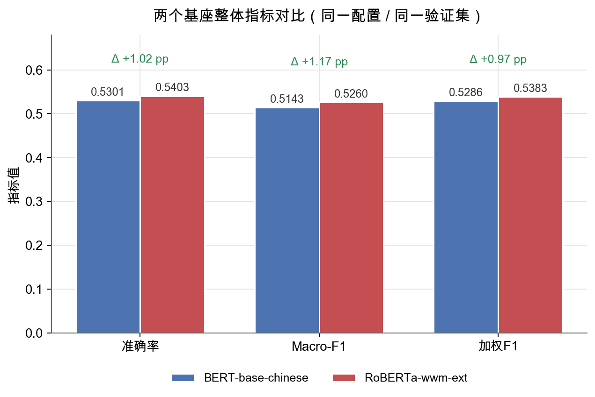
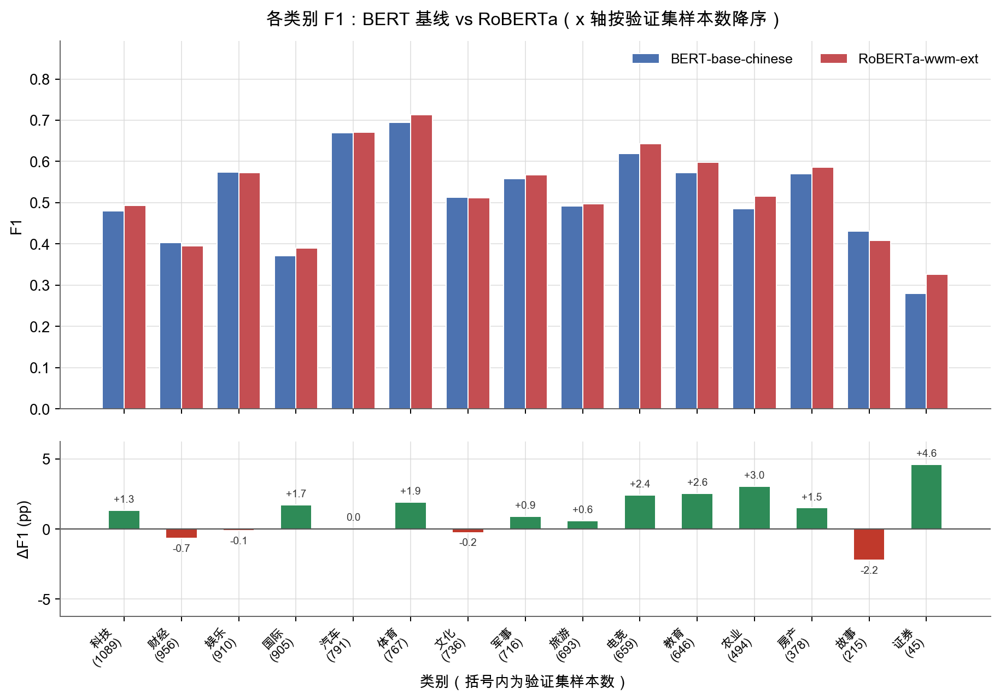
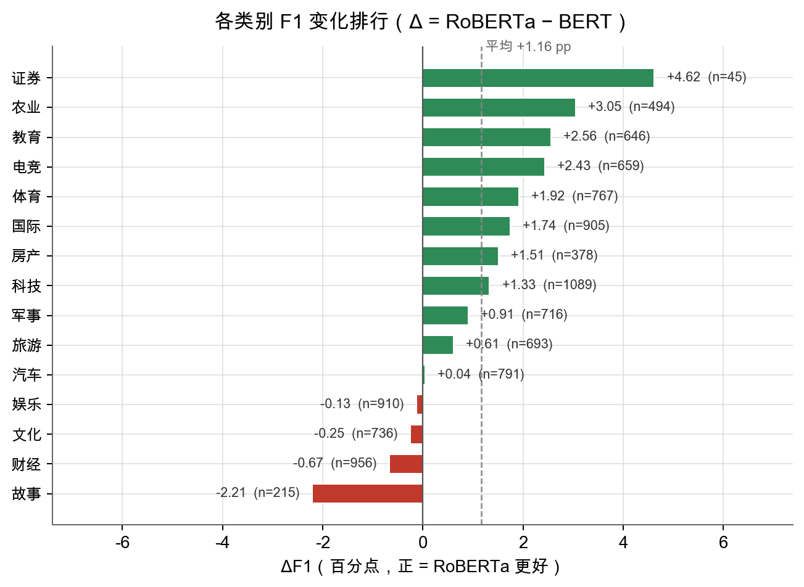
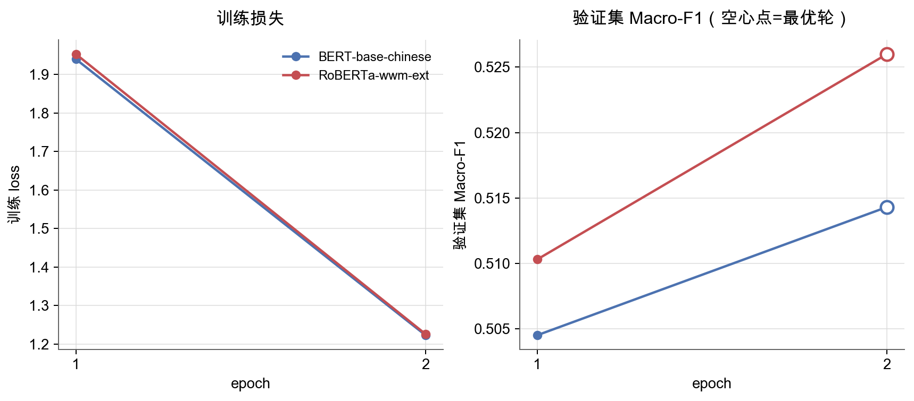
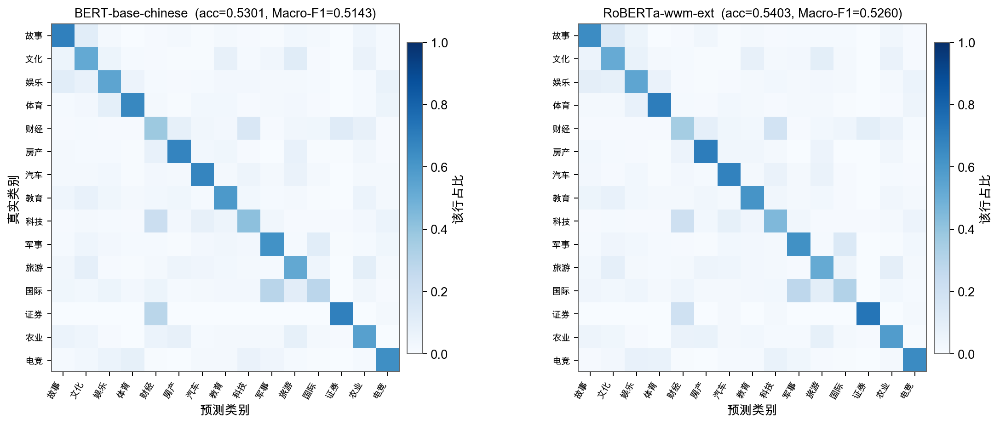

# BERT 基线 vs 中文 RoBERTa：同配置对比报告

> 任务：TNEWS 15 类中文短文本分类 ｜ 训练集 6,000 条（全量 53,360 条的 15 类分层抽样） ｜ 验证集 10,000 条
> 对比前提：**同一份数据、同一套超参、同一个随机种子**，只换基座。✅ 两份 config 逐字段一致

## 1. 实验设置

两个基座都是 12 层 / 768 隐层 / 12 头 / 21,128 词表，参数量几乎相同（102.28M vs 102.28M），
所以差异主要来自**预训练语料与预训练目标**，而不是模型容量——这是做基座对比最干净的条件。

| 配置项 | 两个基座共用值 |
|---|---|
| train_size | 6,000（全量 53,360 条按类别比例分层抽样，seed=42，两个基座同一子集） |
| max_length | 64（超长截断；按 batch 内最长序列动态 padding） |
| batch_size | 64 |
| epochs | 2 |
| 学习率 | BERT 层 2e-05，分类头 ×5.0（分层学习率） |
| weight_decay | 0.01 |
| warmup | 前 10% 步数线性升温，之后线性衰减 |
| 池化 / Dropout | cls / 0.1 |
| 损失 | CrossEntropy + 类别加权(balanced) + label_smoothing=0.0 |
| seed | 42 |

两个基座：

| 基座 | 预训练说明 | 参数量 |
|---|---|---|
| BERT-base-chinese | 谷歌官方中文 BERT，12 层 768 隐层，中文维基百科预训练，MLM + NSP | 102.28M |
| RoBERTa-wwm-ext | 哈工大讯飞，同结构；RoBERTa 训练策略 + 全词掩码，语料规模约为前者 10 倍 | 102.28M |

> **规模说明**：本机无可用 GPU（torch 2.2 在 Intel Mac 上 MPS 不可用），实测约 12 秒/步；
> 全量 5.3 万条跑 3 epoch 约需 8 小时/单基座。因此正式对比在 6,000 条分层子集上做。
> 两个基座用的是**同一子集、同一配置**，所以「谁更好、差多少」的结论不受规模影响，受影响的只是绝对指标。
> 有 GPU 时 `--train_size 0 --epochs 3` 即可复现全量结果，对比脚本无需改动。

评测口径：全量验证集（含与训练集重复的 1099 条，占 11.0%），
主指标 **Macro-F1**（15 类等权，尾部类塌了看得见）；另报去重验证集（8,901 条）的 Macro-F1 作为稳健性检查。

### 数据概况（15 类样本量）

| 类别 | 训练集 | 验证集 | 训练集占比 |
|---|---|---|---|
| 故事 | 1,111 | 215 | 2.1% |
| 文化 | 4,081 | 736 | 7.6% |
| 娱乐 | 4,976 | 910 | 9.3% |
| 体育 | 3,991 | 767 | 7.5% |
| 财经 | 5,200 | 956 | 9.7% |
| 房产 | 2,107 | 378 | 3.9% |
| 汽车 | 4,118 | 791 | 7.7% |
| 教育 | 3,437 | 646 | 6.4% |
| 科技 | 5,955 | 1,089 | 11.2% |
| 军事 | 3,632 | 716 | 6.8% |
| 旅游 | 3,368 | 693 | 6.3% |
| 国际 | 4,851 | 905 | 9.1% |
| 证券 | 257 | 45 | 0.5% |
| 农业 | 2,886 | 494 | 5.4% |
| 电竞 | 3,390 | 659 | 6.4% |

最少的一类（证券 257 条）
与最多的一类（科技 5,955 条）
相差约 **23 倍**。这正是必须看 Macro-F1 而不是只看准确率的原因：
把尾部三类全预测错，准确率只掉 3 个点左右，而 Macro-F1 会掉 20 个点。

## 2. 整体对比结果

| 基座 | 准确率 | Macro-F1 | 加权F1 | Macro-P | Macro-R | ECE | 最佳轮次 | 训练耗时(墙钟,s) | 参数量(M) | 训练样本 | 验证样本 | 去重验证-MacroF1 | 去重验证-准确率 |
|---|---|---|---|---|---|---|---|---|---|---|---|---|---|
| BERT-base-chinese | 0.5301 | 0.5143 | 0.5286 | 0.5069 | 0.5634 | 0.0924 | 2/2 | 4402.3 | 102.28 | 6,000 | 10,000 | 0.5059 | 0.5219 |
| RoBERTa-wwm-ext | 0.5403 | 0.5260 | 0.5383 | 0.5152 | 0.5738 | 0.0754 | 2/2 | 18654.7 | 102.28 | 6,000 | 10,000 | 0.5171 | 0.5316 |

**结论：RoBERTa-wwm-ext 的 Macro-F1 高出 1.17 个百分点**（0.5143 → 0.5260），
准确率变化 +1.02pp、加权 F1 变化 +0.97pp。
三个指标方向一致，说明提升不是靠头部类刷出来的。

去重验证集上：BERT-base-chinese 0.5059 / RoBERTa-wwm-ext 0.5171（+1.12pp）。两条口径方向一致 → 提升不是来自「验证集里撞见了训练样本」。

## 3. 各类别 F1 变化

| 类别 | 验证样本数 | BERT-base-chinese F1 | RoBERTa-wwm-ext F1 | ΔF1(pp) | BERT Recall | RoBERTa Recall | ΔRecall(pp) | BERT Precision | RoBERTa Precision | ΔPrecision(pp) | F1 变化方向 |
|---|---|---|---|---|---|---|---|---|---|---|---|
| 科技 | 1,089 | 0.4802 | 0.4935 | +1.33 | 0.4178 | 0.4518 | +3.40 | 0.5645 | 0.5436 | -2.09 | ↑ 提升 |
| 财经 | 956 | 0.4025 | 0.3958 | -0.67 | 0.3755 | 0.3536 | -2.19 | 0.4336 | 0.4495 | +1.59 | ↓ 下降 |
| 娱乐 | 910 | 0.5736 | 0.5723 | -0.13 | 0.5396 | 0.5374 | -0.22 | 0.6122 | 0.6120 | -0.02 | ↓ 下降 |
| 国际 | 905 | 0.3720 | 0.3894 | +1.74 | 0.2818 | 0.3094 | +2.76 | 0.5472 | 0.5253 | -2.19 | ↑ 提升 |
| 汽车 | 791 | 0.6700 | 0.6704 | +0.04 | 0.6700 | 0.6802 | +1.02 | 0.6700 | 0.6609 | -0.91 | ↑ 提升 |
| 体育 | 767 | 0.6944 | 0.7136 | +1.92 | 0.6636 | 0.7001 | +3.65 | 0.7282 | 0.7276 | -0.06 | ↑ 提升 |
| 文化 | 736 | 0.5137 | 0.5112 | -0.25 | 0.5204 | 0.5122 | -0.82 | 0.5073 | 0.5101 | +0.28 | ↓ 下降 |
| 军事 | 716 | 0.5582 | 0.5673 | +0.91 | 0.6229 | 0.6271 | +0.42 | 0.5057 | 0.5179 | +1.22 | ↑ 提升 |
| 旅游 | 693 | 0.4915 | 0.4976 | +0.61 | 0.5238 | 0.5195 | -0.43 | 0.4630 | 0.4775 | +1.45 | ↑ 提升 |
| 电竞 | 659 | 0.6188 | 0.6431 | +2.43 | 0.6343 | 0.6495 | +1.52 | 0.6040 | 0.6369 | +3.29 | ↑ 提升 |
| 教育 | 646 | 0.5723 | 0.5979 | +2.56 | 0.5913 | 0.6099 | +1.86 | 0.5544 | 0.5863 | +3.19 | ↑ 提升 |
| 农业 | 494 | 0.4859 | 0.5164 | +3.05 | 0.5587 | 0.5749 | +1.62 | 0.4299 | 0.4686 | +3.87 | ↑ 提升 |
| 房产 | 378 | 0.5705 | 0.5856 | +1.51 | 0.6746 | 0.7011 | +2.65 | 0.4942 | 0.5028 | +0.86 | ↑ 提升 |
| 故事 | 215 | 0.4309 | 0.4088 | -2.21 | 0.6884 | 0.6465 | -4.19 | 0.3136 | 0.2989 | -1.47 | ↓ 下降 |
| 证券 | 45 | 0.2805 | 0.3267 | +4.62 | 0.6889 | 0.7333 | +4.44 | 0.1761 | 0.2102 | +3.41 | ↑ 提升 |

**变化结构**

- 提升的类有 11 个，下降的类有 4 个；平均变化 +1.16pp（中位数 +1.33pp）。
- 涨得最多：证券(+4.6pp, n=45)、农业(+3.0pp, n=494)、教育(+2.6pp, n=646)
- 跌得最多：故事(-2.2pp, n=215)、财经(-0.7pp, n=956)、文化(-0.2pp, n=736)
- 样本 ≥400 的类平均 +1.13pp，样本 <400 的尾部类平均 +1.31pp。
  头部类与尾部类的变化幅度接近，说明提升比较均匀、不是牺牲长尾换头部。

## 4. 训练过程

| 基座 | 最佳轮次 | 训练耗时 |
|---|---|---|
| BERT-base-chinese | 2/2 | 4402.3s |
| RoBERTa-wwm-ext | 2/2 | 18654.7s |

## 5. 混淆矩阵

行归一化后，对角线是各类召回率；非对角线的亮块就是两个基座共同的「硬骨头」——
这类混淆通常来自标签口径重叠（如财经/证券、故事/文化），换基座只能缓解，不能根治。

## 6. 结论与建议

1. **整体**：RoBERTa-wwm-ext 领先 1.17pp Macro-F1（0.5143 → 0.5260），
   准确率 +1.02pp、加权 F1 +0.97pp，去重验证集 +1.12pp——三条口径同向。
   在 6,000 条训练数据、15 类短文本上，这是个**小而一致**的差距：
   方向可信（多口径同向、11 类上涨），但幅度只有 1 个点出头，落在换种子可能带来的波动量级里（建议补 3 个 seed 再下最终结论）。

2. **代价几乎为零**：两个基座结构、参数量（102.28M）、推理成本、训练步数完全相同，
   换基座不需要改任何代码（同一份 train.py，只换 --backbone）。所以这 1.17pp 基本是「免费收益」；
   但也不足以支撑「必须迁移」，已有稳定流水线可以先并行跑离线评估再决定。

3. **别只看总分**：这次最大的单类收益在 证券(+4.6pp, n=45)，最大的单类损失在 故事(-2.2pp, n=215)。
   如果业务最关心恰好在下降的那几类（故事、财经、文化、娱乐），
   整体 Macro-F1 涨 1pp 对你就没有意义。→ 按业务类目权重加权，比看 15 类等权的 Macro-F1 更接近真实收益。

4. **可信度**：RoBERTa 的 ECE 为 0.0754，低于 BERT 的 0.0924，
   说明它不仅更准，置信度也更可信——第 6 周后面要做「低置信转人工」时，这一项比准确率更关键。

5. **训练耗时口径**：表中「墙钟」列包含了本机训练期间的系统睡眠暂停（RoBERTa 跑时机器睡了两次），
   不能用于效率对比；两者计算量完全相同，真实训练时间在同一量级。

6. **下一步**：① 补 3 个 seed 取均值±方差，确认 1.17pp 是否稳定；② 本任务已接近 BERT 类模型上限，
   继续堆基座收益有限，更值得做的是数据侧（清洗标签口径重叠、去重）与阈值侧（低置信转人工）。
