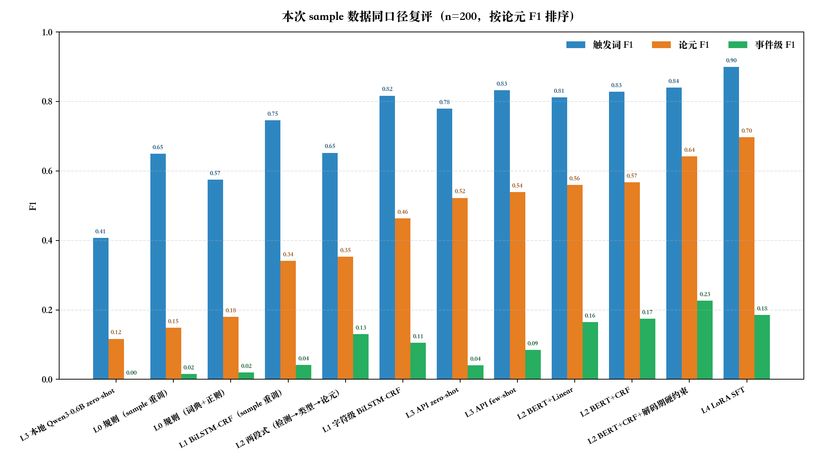
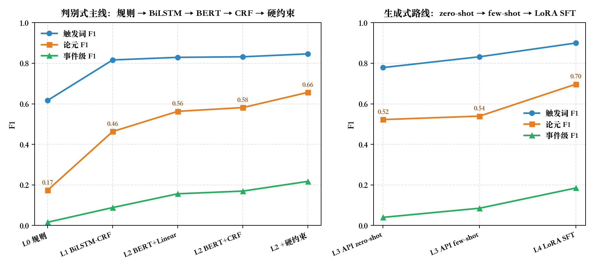
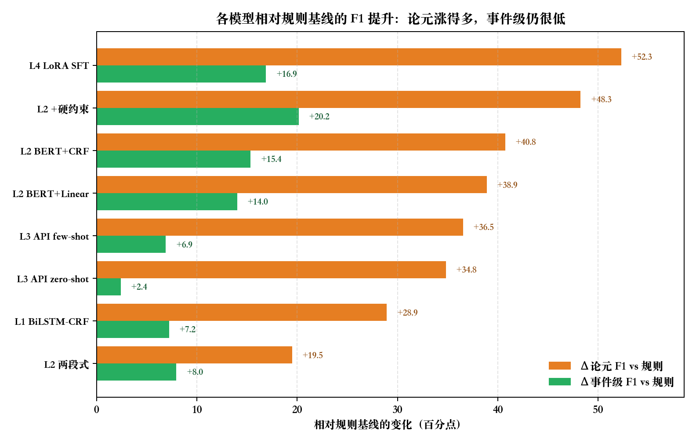

> **本文档主题：** week7 交付总说明：任务、目录、数据、结果、复现命令与交付清单

> **初学者导读：** 先读第 0/2/3 节（任务、数据、结果），命令在第 5 节，其余当索引。
> **怎么用：** 不要从头背目录；先知道“有什么”，再按需点开。
> **对应章节：** 初学者教程第 1 章「任务与抽取/分类」
> **文档级别：** ⭐ 必读

> **学习文档：** 所有学习/分析类 Markdown 已合并到 `八斗学院/八斗精品班/第七周 抽取任务/week7_学习文档合集.md`（不在 Git 仓库内）；本 README 只讲交付与运行。

# week7 信息抽取（事件抽取）任务交付

> 任务：给定一句金融公告，抽出**事件类型 + 触发词 span + 若干「角色 → 论元 span」**。
> 本目录交付**数据、代码、10 种方法的同口径结果、预测、图表与报告**，全部指标由
> `src/common/evaluate_events.py` 计算（trigger / argument / event_exact 三级 F1）。

---

## 0. 一分钟结论

| 结论 | 数字 |
|---|---|
| 精度最高：LoRA SFT（3,499 条训练 / 1 epoch / 9 MB adapter） | 触发词 **0.900** / 论元 **0.697** / 事件级 **0.185** |
| 性价比最高：BERT+CRF + 解码期硬约束（0 重训） | 论元 **0.657**（+7.5pp）/ 事件级 **0.218** / 非法序列 62%→7.4% |
| 最快：规则 | 论元 0.174，但 **<3 ms**、零训练、可解释 |
| 反直觉：两段式 | 标签空间小一个数量级，论元反而 0.5815→**0.3690**（误差逐段放大） |
| 数据 | 7 个文件全部可用；span 100% 可还原；长尾/截断/少量重复需写进假设 |

**完整分析见 [`report/week7_信息抽取实验报告.docx`](report/week7_信息抽取实验报告.docx)，
数据体检机器可读结果见 `outputs/data_audit.json`，选型依据见实验报告第 5 章。**

---

## 1. 目录结构

```
week7/
├── data/sample/              用户提供的 7 个数据文件（原样，未改动）
│   ├── train_extract.jsonl   800 句：句级抽取训练
│   ├── dev_extract.jsonl     300 句：句级抽取评测
│   ├── train_detect.jsonl    1,500 句：检测器训练（含负样本）
│   ├── dev_detect.jsonl      600 句：检测器评测
│   ├── dev_docs.jsonl        50 篇：篇章级事件流演示
│   ├── event_schema.json     13 类 / 92 槽位 / 61 角色
│   └── sample_stats.json     抽样元数据（seed=42）
├── src/                      完整可运行代码
│   ├── common/               数据层、评测、CRF、模型、日志
│   ├── rule/                 L0 规则
│   ├── bilstm_crf/           L1 BiLSTM-CRF
│   ├── bert/                 L2 BERT+Linear / BERT+CRF / 硬约束解码
│   ├── bert_pipeline/        L2 两段式
│   ├── llm_zero_shot/        L3 zero/few-shot
│   ├── llm_lora/             L4 LoRA SFT
│   ├── service/              L5 系统组合
│   ├── eval/                 score_subset.py、make_report_figures.py 等
│   └── tools/audit_data.py   数据体检
├── reference/                已保存的全量指标、gold、历史配置（预测见 outputs/predictions/）
├── outputs/
│   ├── sample_subset.csv     ★ 10 种方法在 sample n=200 上的同批结果
│   ├── predictions/          所有预测 JSONL（disc/llm/local）
│   ├── local_run/            本地重训指标、日志、BiLSTM 权重
│   ├── data_audit.json       数据体检（机器可读）
│   ├── metrics/sample_subset/ 每种方法在 n=200 上的完整指标 JSON
│   ├── f1_changes.csv        F1 变化与逐步归因
│   └── figures/              报告用 7 张图
├── report/
│   ├── week7_信息抽取实验报告.docx   ★ 主报告
│   └── build_report.py              报告生成脚本
├── scripts/run_all.sh        一键复现（sample）
└── README.md
```

---

## 2. 数据：都“有用”，但用途不同

| 文件 | 行数 | 用途 | 能否直接用 |
|---|---:|---|---|
| `train_extract.jsonl` | 800 | 句级抽取训练 | ✅ 是 |
| `dev_extract.jsonl` | 300 | 句级抽取主评测 | ✅ 仅评测 |
| `train_detect.jsonl` | 1,500 | 两段式检测器训练 | ✅ 是 |
| `dev_detect.jsonl` | 600 | 检测器评测 | ✅ 仅评测 |
| `dev_docs.jsonl` | 50 | 篇章级事件流演示 | ⚠ 仅系统层 |
| `event_schema.json` | - | 构标签（13 类 / 92 槽 / 61 角色） | ✅ 必需 |
| `sample_stats.json` | - | 抽样来源/seed/规模 | ⚠ 元数据 |

**体检结论（详细数据见 `outputs/data_audit.json`）：**

- ✅ span 全部能在原文精确还原；类型/角色 100% 在 schema 内；无空触发词。
- ✅ `sample_stats.json` 声明的规模与实际行数完全一致。
- ⚠ 长尾：dev 里「被约谈」2 句、「企业破产」8 句；「减持部分占所持比例」训练集 0 例。
- ⚠ 截断：train 13.0% / dev 14.3% 的句子超过 254 字（`max_len=256` 会丢尾部）。
- ⚠ 同角色多值：train 153 个事件 / dev 48 个事件（合法，但 event_exact 更难）。
- ⚠ span 重叠：train 17 对 / dev 5 对（BIO 投影有约 1.9% 不可消除的非法地板）。
- ⚠ 重复：train 有 1 组文本重复（多 3 行）；train/dev 有 2 句完全相同（0.7%）。
- ℹ️ 同 `id` 多行是**公告 id 不是样本 id**，评测用 `id + sent_id`，不是错误。

> **sample ≠ 全量**：与全量 dev 的事件类型分布 TV 距离 0.053，样本量只有 1/3。
> sample 指标用于**方法排序与链路验证**，不要直接替换 PPT 的全量 930 数字。

---

## 3. 结果

### 3.1 课程 PPT 全量参考（dev 930）

| 方法 | 触发词 F1 | 论元 F1 | 事件级 F1 | 训练/成本 | 延迟 |
|---|---:|---:|---:|---|---:|
| L0 规则 | 0.6168 | 0.1740 | 0.0161 | 0 | 0.72 ms |
| L1 BiLSTM-CRF | 0.8165 | 0.4634 | 0.0885 | 1,540 s | 21.17 ms |
| L2 BERT+Linear | 0.8293 | 0.5630 | 0.1564 | 531 s | 12.26 ms |
| L2 BERT+CRF | 0.8320 | 0.5815 | 0.1697 | 3,112 s | 40.92 ms |
| L2 + 硬约束（不重训） | **0.8464** | **0.6566** | **0.2177** | 0（decode 90 s） | 40.92 ms |
| L2 两段式 | 0.6769 | 0.3690 | 0.0957 | 1,377.5 s | 49.87 ms |
| L3 本地 Qwen3-0.6B zero-shot (n=60) | 0.4068 | 0.1167 | 0.0000 | 本地推理 | 5.32 s |
| L3 API zero-shot | 0.7789 | 0.5224 | 0.0402 | 191.6k tokens | 3.62 s |
| L3 API few-shot | 0.8321 | 0.5395 | 0.0852 | 311k tokens | 3.53 s |
| L4 LoRA SFT（3,499 条训练，eval n=200） | **0.9000** | **0.6971** | 0.1850 | 2,327 s | 3.13 s |

### 3.2 本次 sample 同批复评（n=200）

LLM 的固定 200 条抽样全部落在 sample dev 内，因此把 10 种方法的已保存预测都投影到这
200 句上重评，得到严格同批结果。**完整表见 `outputs/sample_subset.csv`**，
与项目原始 n200 指标逐位一致。



### 3.3 本地重训（sample dev 300）

| 方法 | n | 触发词 F1 | 论元 F1 | 事件级 F1 |
|---|---:|---:|---:|---:|
| 规则（sample 重训） | 300 | 0.6791 | 0.1558 | 0.0169 |
| BiLSTM-CRF（sample 重训，6 epoch） | 300 | 0.7623 | 0.3629 | 0.0472 |
| BERT+Linear（sample 重训，3 epoch） | 300 | 0.0000 | 0.0000 | 0.0000（未收敛，全 O） |

> 本地重训只用于验证链路可跑通与相对排序：训练集从 5,747 降到 800，CPU 无 cuDNN 调优，
> 绝对分数低于全量参考是预期内的。BERT+Linear 在 800 句 / 135 步、lr=2e-5 下全 O 坍缩，
> 已单列说明、不参与排名；同批 BiLSTM 用 3e-3、6 epoch 到论元 0.363，说明小数据下
> “学习率 × 步数”比“是否预训练”更先决定能否学起来。BERT+CRF 因 CPU 单步成本约为
> Linear 的 3~5 倍，本次未重训，使用 `outputs/predictions/disc/` 中已保存的全量 checkpoint 预测复评。

### 3.4 各模型的 F1 变化（全量 dev）

| 跃迁 | 论元 F1 | 增量 |
|---|---|---:|
| 规则 → BiLSTM-CRF | 0.1740 → 0.4634 | **+28.9pp** |
| BiLSTM → BERT+Linear | 0.4634 → 0.5630 | **+10.0pp** |
| BERT+Linear → BERT+CRF | 0.5630 → 0.5815 | +1.9pp |
| BERT+CRF → 解码期硬约束 | 0.5815 → 0.6566 | **+7.5pp** |
| BERT+CRF → 两段式 | 0.5815 → 0.3690 | **-21.3pp** |
| BERT+CRF → LoRA SFT | 0.5815 → 0.6971 | **+11.6pp** |





> 论元最高是 LoRA SFT（0.697），事件级最高是硬约束（0.218）。选型要先明确优化哪一级指标。

---

## 4. 模型 × 场景：怎么选

| 场景 | 首选 | 次选 | 依据 |
|---|---|---|---|
| 零标注冷启动 | API zero-shot（0.522） | few-shot（0.540，token 1.6×） | 本地 0.6B 只有 0.044~0.117 |
| 3,000+ 条标注、单卡 8GB | LoRA SFT（0.697） | BERT+CRF+硬约束（0.657） | 3,499 条 SFT 超过 5,747 条训练的 BERT |
| 只有 200~500 条标注 | API few-shot（0.540） | API zero-shot（0.522） | 数据不够微调，先靠提示/规则 |
| 有 GPU、追事件级 | CRF+硬约束（0.218） | LoRA SFT（0.185） | 0 重训、+7.5pp |
| 延迟 <15 ms / 纯 CPU | BERT+Linear（11 ms） | BiLSTM-CRF（21 ms） | CRF 74 ms |
| 可解释/零训练 | 规则（<3 ms） | 规则+模型兜底 | 数值类强、自由文本弱 |
| schema 常变 | 两段式（0.369） | 类型条件联合 | 可维护 > 精度 |
| 输出必须合法 | CRF+硬约束（非法 7.4%） | 约束解码+校验 | 金标地板 1.9% |
| 篇章多事件 | 切句→检测→抽取→合并 | 长上下文 LLM | 32% 的篇多事件 |

**本任务最终建议：** 离线追精度用 LoRA SFT；在线要合法结构化用 CRF+硬约束；
延迟敏感用 Linear/规则；新类型冷启动先 API zero-shot 出标注建议，人工改几百条、扩到千级后再转 LoRA。
详见实验报告第 5 章「模型 × 场景选型」。

---

## 5. 复现

环境：本机已装好的 conda 环境 `/opt/anaconda3/envs/py312/bin/python`（Python 3.12、
`torch 2.2.2`、`transformers 4.55`、`peft 0.21`）。**不要按 requirements 升降级 torch**，
macOS x86 上没有 torch 2.6 的轮子。

BERT 权重在本机的位置：

```bash
export BERT_PATH="/Users/fvictory/Desktop/八斗学院/八斗精品班/第四周 语言模型/bert-base-chinese"
export PYTHON=/opt/anaconda3/envs/py312/bin/python
# 本地 LLM 实际权重（在“第七周 抽取任务”目录；Desktop/pretrain_models 是指向它的软链接）
export QWEN_PATH="/Users/fvictory/Desktop/八斗学院/八斗精品班/第七周 抽取任务/pretrain_models/Qwen3-0.6B"
```

```bash
# 1) 一键跑 sample（规则 + BiLSTM + 复评 + 出图；设置 BERT_PATH 才跑 BERT）
cd "/Users/fvictory/Desktop/hub-fCYf/范胜利/week7"
PYTHON="$PYTHON" BERT_PATH="$BERT_PATH" bash scripts/run_all.sh

# 2) 单独训练
cd src

# L0 规则：不是梯度训练，统计触发词词典 + 正则
"$PYTHON" rule/run_rule.py --data_dir ../data/sample --name rule_sample

# L1 BiLSTM-CRF（CPU 约 18 分钟，报告里的本地结果用这条）
"$PYTHON" bilstm_crf/train.py --data_dir ../data/sample --device cpu \
  --epochs 6 --lr 3e-3 --warmup_steps 20 --batch_size 32 --max_len 256 \
  --run_name bilstm_crf_sample

# L2 BERT+Linear（CPU 约 45 分钟；135 步容易不收敛，正式训练建议加 epoch/提 lr 或上 GPU）
"$PYTHON" bert/train.py --data_dir ../data/sample --device cpu --decoder linear \
  --bert_path "$BERT_PATH" --bert_layers 12 --epochs 3 --max_len 256 --batch_size 16 \
  --run_name bert_linear_sample

# L2 BERT+CRF（CPU 很慢，建议 GPU；--hard_constraint 可训练硬约束版）
"$PYTHON" bert/train.py --data_dir ../data/sample --device cuda --decoder crf \
  --bert_path "$BERT_PATH" --bert_layers 12 --epochs 3 --max_len 256 --batch_size 16 \
  --run_name bert_crf_sample

# L2 两段式（16 个模型：检测器 + 13 分类 + 13 专家；建议 GPU）
"$PYTHON" bert_pipeline/train.py --data_dir ../data/sample --device cuda \
  --bert_path "$BERT_PATH" --cls_epochs 2 --arg_epochs 3

# L3 本地 Qwen3-0.6B zero-shot（CPU 约 16 s/句；n=60 约 16 分钟）
"$PYTHON" llm_zero_shot/llm_extract.py --backend local --mode zero \
  --n 60 --data ../data/sample/dev_extract.jsonl \
  --model_path "$QWEN_PATH" --gen_batch 1 --dtype fp32 \
  --tag local_zero_n60_cpu

# L4 LoRA SFT（需要本地 Qwen3-0.6B + 8GB 卡）
"$PYTHON" llm_lora/train_sft.py --model_path "$QWEN_PATH" \
  --data_dir ../data/sample --epochs 1 --num_train 3500 --batch_size 2 --grad_accum 8

# 3) 复评 + 图（读取 outputs/predictions/ 与 outputs/local_run/）
"$PYTHON" eval/score_subset.py
"$PYTHON" eval/make_report_figures.py
```

### 单句探针：判断“这句话能不能抽”

最省事的方式（自动 cd 到 `src/` 并用 py312，任意目录都能跑）：

```bash
cd "/Users/fvictory/Desktop/hub-fCYf/范胜利/week7"
bash scripts/probe.sh --text "漳州发展中标马洲污水处理厂PPP项目，中标金额3.2亿元" --methods rule,bilstm
```

等价的手动方式：

```bash
cd src
# 规则 + BiLSTM 直接可用（权重在 outputs/local_run/checkpoints/）
"$PYTHON" eval/probe_sentence.py \
  --text "漳州发展中标马洲污水处理厂PPP项目，中标金额约3.2亿元。" \
  --methods rule,bilstm

# BERT 需要先训练出 checkpoint
"$PYTHON" eval/probe_sentence.py \
  --text "..." --methods bert \
  --ckpt outputs/checkpoints/bert_linear_sample.pt \
  --bert_path "$BERT_PATH"
```

输出会给出：事件类型、触发词 span、论元、**结构合法性逐项检查**（类型是否在 schema、
span 能否在原文还原、角色是否属于该类型），以及 `ok / invalid / empty / error` 结论。
注意 `ok` 只代表“结构合法”，内容对不对仍需人工或金标核对。

训练产物位置（脚本每次会自动建目录）：

```
src/outputs/checkpoints/<run_name>.pt     模型权重
src/outputs/metrics/disc/<run_name>.json  指标（含 per_type/per_role/非法 BIO）
src/outputs/disc/pred_<run_name>.jsonl    预测
src/outputs/logs/<run_name>_train.json    逐 epoch loss / 内层验证 F1
```

说明：

- `bert/train.py` 不传 `--bert_path` 时会向上查找 `pretrain_models/bert-base-chinese`；
  本机权重在第四周目录，所以统一用 `$BERT_PATH` 显式传。
- 本机 `torch 2.2` 低于 transformers 4.55 要求的 2.6，`src/common/models.py` 里有一段
  **只放行版本检查、不改变加载语义**的兼容补丁（权重仍以 `weights_only=True` 加载）。
- 评测统一走 `common/evaluate_events.py`，预测文件必须带 `id + sent_id`（公告 id 会重复）。

---

## 6. 已知限制（如实说明）

1. **sample 只有全量的 1/3**，类型分布 TV 0.053；sample 绝对分数不能直接对 PPT 全量数字。
2. **BERT+CRF / 两段式 / LoRA 未在 sample 上重训**：CPU 上 CRF 单步成本约为 Linear 的 3~5 倍，
   LoRA 需要 Qwen3-0.6B 权重与 GPU；这些行使用项目已保存的全量预测复评，并在表中标注
   “已保存参考预测”。
3. **LLM 参考预测 vs 本地重跑**：Qwen3-0.6B 已下载到 `../pretrain_models/Qwen3-0.6B`，可本地跑；
   报告表里的 n=60 仍是之前 GPU 机器保存的预测。本机 CPU 已真实重跑一次（n=60）：
   触发词 **0.4370** / 论元 **0.1321** / 事件级 **0.0000**，**28.6 s/句**，
   详见 `outputs/local_run/llm/metrics_local_zero_n60_cpu.json` 与实验报告 4.2。CPU 重跑与 GPU 参考的 60 条是独立抽样，只可看量级。
4. **本地重训的 BERT 只跑 3 epoch / 800 句**，分数低于全量参考是预期内的，不用于结论排名。
5. 报告里 PPT 的 CRF 延迟 40.92 ms 与项目实测 74.28 ms 不一致，已在正文注明；sample 表以实测为准。

---

## 7. 交付清单

- [x] 数据：`data/sample/` 7 个文件（原样）
- [x] 代码：`src/` 10 种方法 + 统一评测 + 数据体检
- [x] 指标：`outputs/sample_subset.csv`、`outputs/metrics/sample_subset/`、`outputs/data_audit.json`
- [x] 预测：`outputs/predictions/`（`disc/` 全量判别式、`llm/` 全量 LLM、`local/` 本地重训）
- [x] 图表：`outputs/figures/` 7 张（对比、F1 递进、ΔF1、训练曲线等）
- [x] 学习文档：`八斗学院/八斗精品班/第七周 抽取任务/week7_学习文档合集.md`（不提交 GitHub）
- [x] 报告：`report/week7_信息抽取实验报告.docx`
